# Complemento visual das aulas

Revisão concluída em 06/11/2026 para as sete transcrições que correspondem às seis gravações locais. Foram triados os trechos relevantes das transcrições e conferidos quadros nos timestamps registrados. Não houve audição integral nem revisão de cada frame dos vídeos.

As 13 imagens incluídas vêm dos materiais do repositório, com conteúdo equivalente observado nos vídeos. Os vídeos serviram para conferência; câmeras e interfaces de reunião não foram incluídas. Tutoriais de busca e obtenção de artigos ficaram fora do escopo, conforme orientação do aluno.

## Cobertura por transcrição

- [2026-09-18 1849 - Metodologia de Pesquisa - Aula 1.pt.md](../transcricoes/2026-09-18%201849%20-%20Metodologia%20de%20Pesquisa%20-%20Aula%201.pt.md): **3 imagens**. Conteúdo original reproduzido e conferido no vídeo.

- [2026-09-19 0756 - Metodologia de Pesquisa - Aula 2 - Parte 1 - Segmento 1.pt.md](../transcricoes/2026-09-19%200756%20-%20Metodologia%20de%20Pesquisa%20-%20Aula%202%20-%20Parte%201%20-%20Segmento%201.pt.md): **4 imagens**. Conteúdo original reproduzido e conferido no vídeo.

- [2026-09-19 0756 - Metodologia de Pesquisa - Aula 2 - Parte 1 - Segmento 2.pt.md](../transcricoes/2026-09-19%200756%20-%20Metodologia%20de%20Pesquisa%20-%20Aula%202%20-%20Parte%201%20-%20Segmento%202.pt.md): **0 imagens**. Revisado; nenhuma imagem de material equivalente foi selecionada.

- [2026-09-19 1333 - Metodologia de Pesquisa - Aula 2 - Parte 2.pt.md](../transcricoes/2026-09-19%201333%20-%20Metodologia%20de%20Pesquisa%20-%20Aula%202%20-%20Parte%202.pt.md): **0 imagens**. Revisado; nenhuma imagem de material equivalente foi selecionada.

- [2026-10-02 1854 - Metodologia de Pesquisa.pt.md](../transcricoes/2026-10-02%201854%20-%20Metodologia%20de%20Pesquisa.pt.md): **0 imagens** neste guia.

- [2026-10-16 - Metodologia de Pesquisa.pt.md](../transcricoes/2026-10-16%20-%20Metodologia%20de%20Pesquisa.pt.md): **0 imagens**. Revisado; nenhuma imagem de material equivalente foi selecionada.

- [2026-10-30 - Metodologia de Pesquisa.pt.md](../transcricoes/2026-10-30%20-%20Metodologia%20de%20Pesquisa.pt.md): **6 imagens**. Conteúdo original reproduzido e conferido no vídeo.

## 18/09 e 19/09 — páginas conferidas

Os timestamps abaixo identificam o ponto do vídeo inspecionado, sem certificar toda a duração de exibição de um slide. Os segmentos da manhã de 19/09 usam o relógio da gravação inteira da Parte 1. Não houve audição integral.

### 18/09 · 01:59:00–02:00:07 — Classificação da pesquisa

**Fonte incluída:** [Parte2-MetodologiaPesquisa2026.pdf, p. 18](../materiais/Parte2-MetodologiaPesquisa2026.pdf#page=18). [Transcrição](../transcricoes/2026-09-18%201849%20-%20Metodologia%20de%20Pesquisa%20-%20Aula%201.pt.md).

**Conferência no vídeo:** 01:59:30. A fala enumera finalidade, objetivo, procedimentos, natureza dos dados e local de realização, na ordem do slide.

**Utilidade:** O quadro reúne as dimensões que ajudam a caracterizar o método do TCC.

**Observação:** A classificação da pesquisa concreta do aluno ainda depende do protocolo; o slide não decide isso por ele.

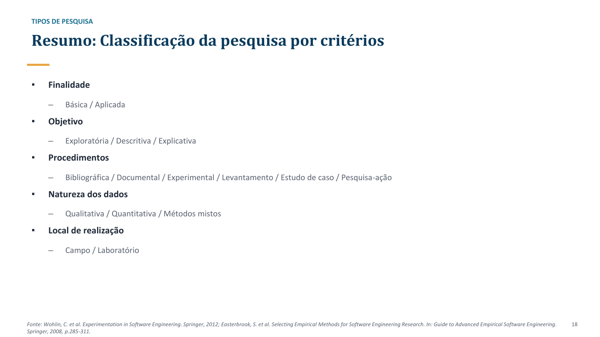

### 18/09 · 02:31:50–02:33:54 — Fases da elaboração da pesquisa

**Fonte incluída:** [Parte2-MetodologiaPesquisa2026.pdf, p. 34](../materiais/Parte2-MetodologiaPesquisa2026.pdf#page=34). [Transcrição](../transcricoes/2026-09-18%201849%20-%20Metodologia%20de%20Pesquisa%20-%20Aula%201.pt.md).

**Conferência no vídeo:** 02:32:49. Em 02:32:49, o docente refere-se à formulação do problema e identifica a revisão da literatura como passo quatro, como no diagrama.

**Utilidade:** A sequência tema → objetivos → problema → revisão → dados → comunicação fica visível.

**Observação:** É uma visão geral do processo, sem tutoriais de recuperação de artigos.

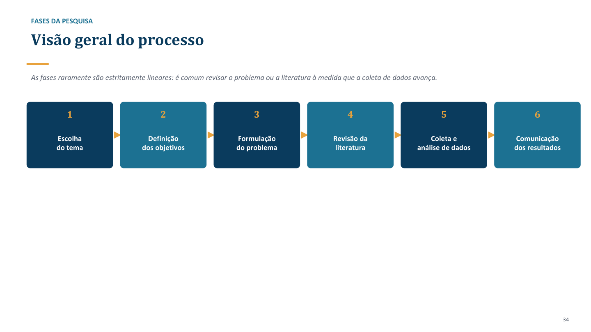

### 18/09 · 02:51:08–02:53:32 — Ciclo de vida do trabalho científico

**Fonte incluída:** [Parte2-MetodologiaPesquisa2026.pdf, p. 47](../materiais/Parte2-MetodologiaPesquisa2026.pdf#page=47). [Transcrição](../transcricoes/2026-09-18%201849%20-%20Metodologia%20de%20Pesquisa%20-%20Aula%201.pt.md).

**Conferência no vídeo:** 02:52:14. A fala percorre identificar problema, fazer revisão/mapeamento, formular hipótese, criar soluções e analisar resultados, como nas cinco caixas.

**Utilidade:** Mostra a relação entre problema, evidências, hipóteses e avaliação.

**Observação:** Em 02:53:32 o docente ressalva que o TCC não exige executar todo esse ciclo.

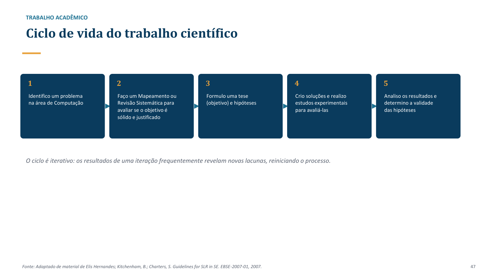

### 19/09 — manhã · 00:04:27–00:05:42 — Estudos primários e secundários

**Fonte incluída:** [Parte3-RevisaoSistematica2026.pdf, p. 6](../materiais/Parte3-RevisaoSistematica2026.pdf#page=6). [Transcrição](../transcricoes/2026-09-19%200756%20-%20Metodologia%20de%20Pesquisa%20-%20Aula%202%20-%20Parte%201%20-%20Segmento%201.pt.md).

**Conferência no vídeo:** 00:05:42. A fala diz “esse aqui seria o fluxo” e associa estudos de caso, surveys e experimentos à síntese que gera evidências e novas áreas.

**Utilidade:** O diagrama representa a passagem de estudos individuais para uma síntese.

**Observação:** Não se trata de uma instrução de busca em bases.

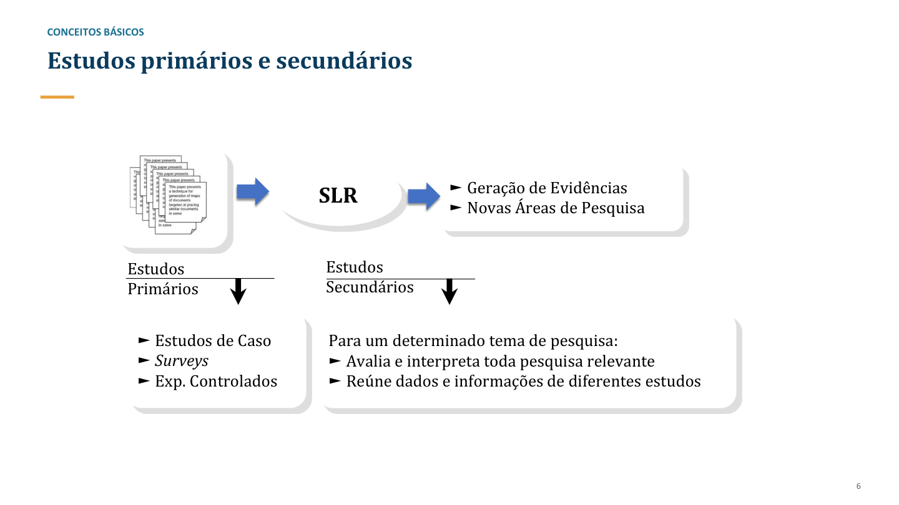

### 19/09 — manhã · 00:21:09–00:22:18 — Processo da revisão e empacotamento

**Fonte incluída:** [Parte3-RevisaoSistematica2026.pdf, p. 12](../materiais/Parte3-RevisaoSistematica2026.pdf#page=12). [Transcrição](../transcricoes/2026-09-19%200756%20-%20Metodologia%20de%20Pesquisa%20-%20Aula%202%20-%20Parte%201%20-%20Segmento%201.pt.md).

**Conferência no vídeo:** 00:22:18. O docente descreve planejamento, execução, análise de resultados e destaca o empacotamento, presente na faixa inferior do diagrama.

**Utilidade:** Preserva as relações e retornos entre fases, que a transcrição linear perde.

**Observação:** O diagrama foi confirmado no vídeo em 00:22:18. A conferência é pontual, sem audição integral.

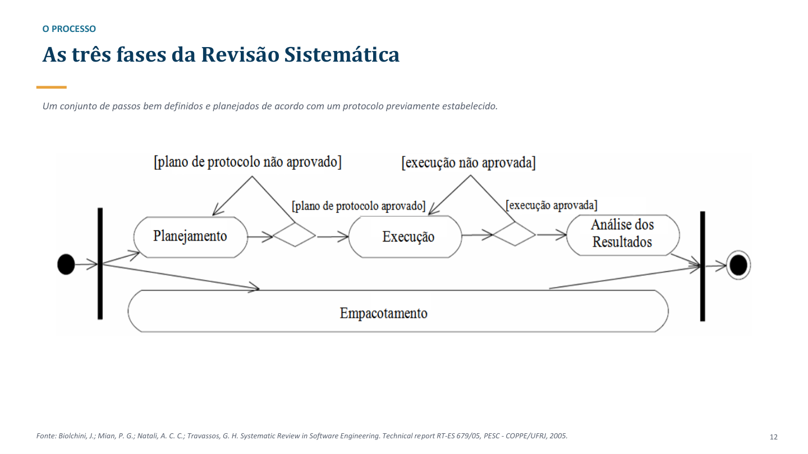

### 19/09 — manhã · 00:28:05–00:30:19 — PICOC: construção da questão de pesquisa

**Fonte incluída:** [Parte3-RevisaoSistematica2026.pdf, p. 16](../materiais/Parte3-RevisaoSistematica2026.pdf#page=16). [Transcrição](../transcricoes/2026-09-19%200756%20-%20Metodologia%20de%20Pesquisa%20-%20Aula%202%20-%20Parte%201%20-%20Segmento%201.pt.md).

**Conferência no vídeo:** 00:30:19. Coincidem os exemplos de hipertensão/medicamentos X e Y/12 semanas e projetos de software de médio porte/testes automatizados versus manuais.

**Utilidade:** A disposição lado a lado permite relacionar cada componente à pergunta resultante.

**Observação:** Exemplos didáticos para formular a pergunta, sem definir o tema do aluno nem orientar busca de artigos.

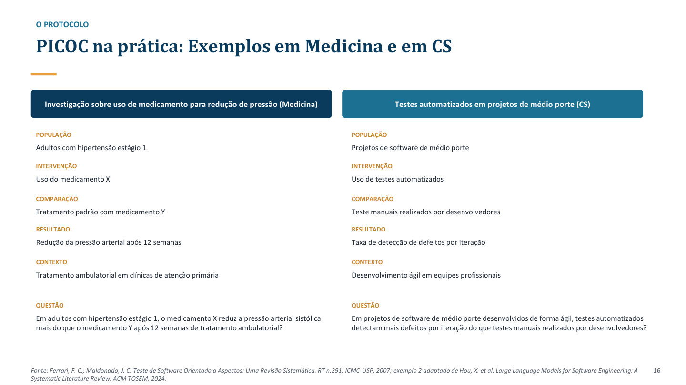

### 19/09 — manhã · 01:09:38–01:13:07 — Exemplo do fluxograma PRISMA

**Fonte incluída:** [Parte3-RevisaoSistematica2026.pdf, p. 26](../materiais/Parte3-RevisaoSistematica2026.pdf#page=26). [Transcrição](../transcricoes/2026-09-19%200756%20-%20Metodologia%20de%20Pesquisa%20-%20Aula%202%20-%20Parte%201%20-%20Segmento%201.pt.md).

**Conferência no vídeo:** 01:10:46. Coincidem 1.563 registros iniciais, 1.141 triados, 1.133 excluídos, 8 textos completos avaliados, 5 excluídos e 3 incluídos.

**Utilidade:** As caixas e setas ajudam a compreender o relato da seleção dos estudos.

**Observação:** Há uma divergência no próprio slide: a caixa “Records after duplicates removed” traz 422, enquanto a fala e a caixa de triagem usam 1.141. A diferença 1.563 − 1.141 é 422, mas não foi corrigido o rótulo da fonte. Não copiar esses números para a pesquisa do aluno.

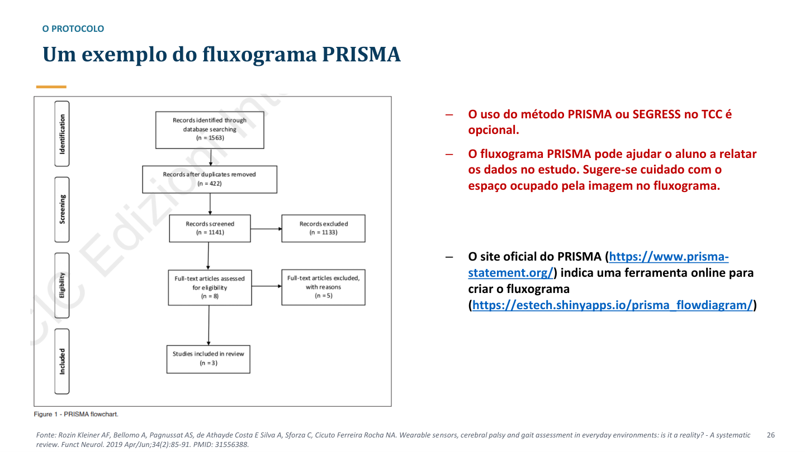

### Apoios conceituais mantidos como relações parciais

Os registros abaixo são apoios conceituais. As demonstrações da StArt de 19/09 foram posteriormente conferidas nos vídeos, mas não foi localizado material equivalente às telas práticas; continuam sem reprodução inserida. A lista de seções de 18/09 foi mantida como referência textual, sem nova imagem.

- **Seções do artigo — 00:13:23**, em [2026-09-18 1849 - Metodologia de Pesquisa - Aula 1.pt.md](../transcricoes/2026-09-18%201849%20-%20Metodologia%20de%20Pesquisa%20-%20Aula%201.pt.md): [Parte1-AlinhamentosIniciais2026.pdf, p. 8](../materiais/Parte1-AlinhamentosIniciais2026.pdf#page=8). Coincidem as seções centrais enumeradas em aula. O slide também menciona as referências. Lista textual; basta consultar a página, sem inserir outra imagem.

- **Construção do formulário de extração — 03:21:20–03:29:18**, em [2026-09-19 0756 - Metodologia de Pesquisa - Aula 2 - Parte 1 - Segmento 2.pt.md](../transcricoes/2026-09-19%200756%20-%20Metodologia%20de%20Pesquisa%20-%20Aula%202%20-%20Parte%201%20-%20Segmento%202.pt.md): [Parte3-RevisaoSistematica2026.pdf, p. 23](../materiais/Parte3-RevisaoSistematica2026.pdf#page=23). O slide trata de avaliação da qualidade e formulário de extração, mas não contém os controles Pick One/Pick Many nem o formulário construído na StArt. A tela prática foi conferida no vídeo; os materiais examinados não contêm equivalente para reprodução.

- **Extração e gráficos de sumarização — 00:08:24–00:18:42**, em [2026-09-19 1333 - Metodologia de Pesquisa - Aula 2 - Parte 2.pt.md](../transcricoes/2026-09-19%201333%20-%20Metodologia%20de%20Pesquisa%20-%20Aula%202%20-%20Parte%202.pt.md): [Parte3-RevisaoSistematica2026.pdf, p. 24](../materiais/Parte3-RevisaoSistematica2026.pdf#page=24). O slide enumera tabelas, estatística e gráficos; a demonstração fala de formulários preenchidos, árvores e grafos concretos da ferramenta. A demonstração foi conferida no vídeo; os gráficos e a tela exatos não foram localizados nos materiais examinados.

## 30/10 — slides e documentos conferidos

As seis capturas da gravação foram substituídas por conteúdo dos arquivos originais do repositório, após comparação visual nos timestamps indicados. Agora as imagens mostram apenas slides, o resumo estruturado e o fluxograma, sem câmera, controles do leitor ou interface de reunião.

Os quatro slides vêm dos PDFs das Partes 5 e 6. Os dois TCCs foram extraídos sem alteração do [ZIP de exemplos](../materiais/ExemploArtigosRevisaoSistematica.zip) para [materiais/exemplos/](../materiais/exemplos/). Do TCC de Davi foi reproduzido apenas o resumo da página 1; do TCC de Marcos foi extraída a imagem do fluxograma da página 4. As fontes completas permanecem acessíveis.

**Prioridade principal:** resumo estruturado e fluxograma. **Apoio:** três exemplos de formatação e roteiro da apresentação. A conferência foi visual e pontual, sem audição integral nem validação acadêmica dos exemplos.

### 00:14:30 — Citação direta curta e longa

**Fonte incluída:** [Parte5-TrechosABNT2026.pdf, p. 13](../materiais/Parte5-TrechosABNT2026.pdf#page=13). [Transcrição](../transcricoes/2026-10-30%20-%20Metodologia%20de%20Pesquisa.pt.md).

**Conferência no vídeo:** 00:14:30. Conteúdo do material original comparado ao quadro do vídeo, incluindo textos, números e organização visual.

**Utilidade:** A disposição das aspas, do bloco recuado e da indicação de autoria é visual; a fala isolada não conserva essa formatação.

**Observação:** Slide didático de citação direta. As afirmações normativas e as referências do exemplo não foram verificadas independentemente.

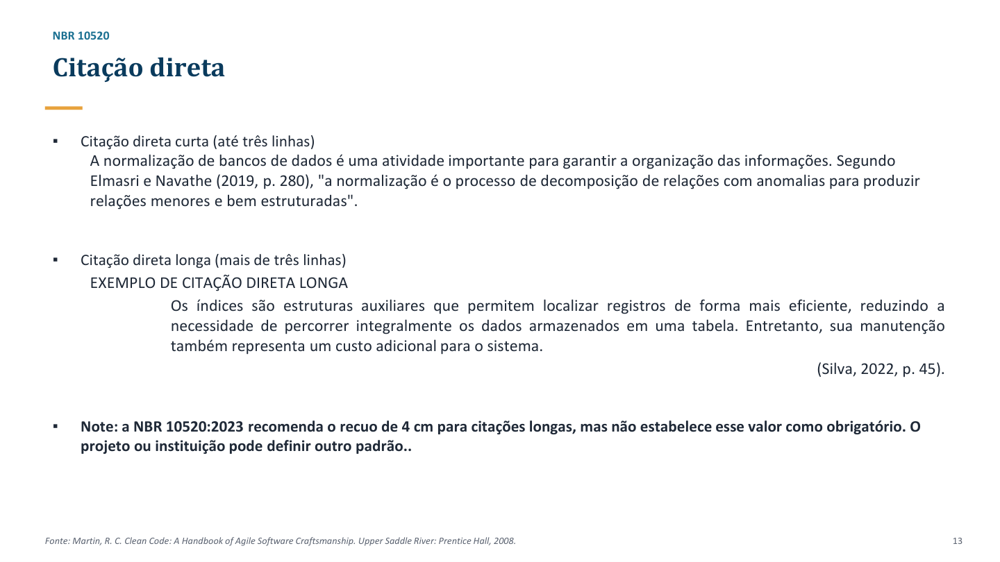

### 00:22:30 — Citações no texto e lista de referências

**Fonte incluída:** [Parte5-TrechosABNT2026.pdf, p. 20](../materiais/Parte5-TrechosABNT2026.pdf#page=20). [Transcrição](../transcricoes/2026-10-30%20-%20Metodologia%20de%20Pesquisa.pt.md).

**Conferência no vídeo:** 00:22:30. Conteúdo do material original comparado ao quadro do vídeo, incluindo textos, números e organização visual.

**Utilidade:** O antes/depois e o contraste entre maiúsculas e minúsculas tornam a diferença visível.

**Observação:** Registra o que o slide da aula apresenta; conferir a norma e o template aplicáveis ao escrever.

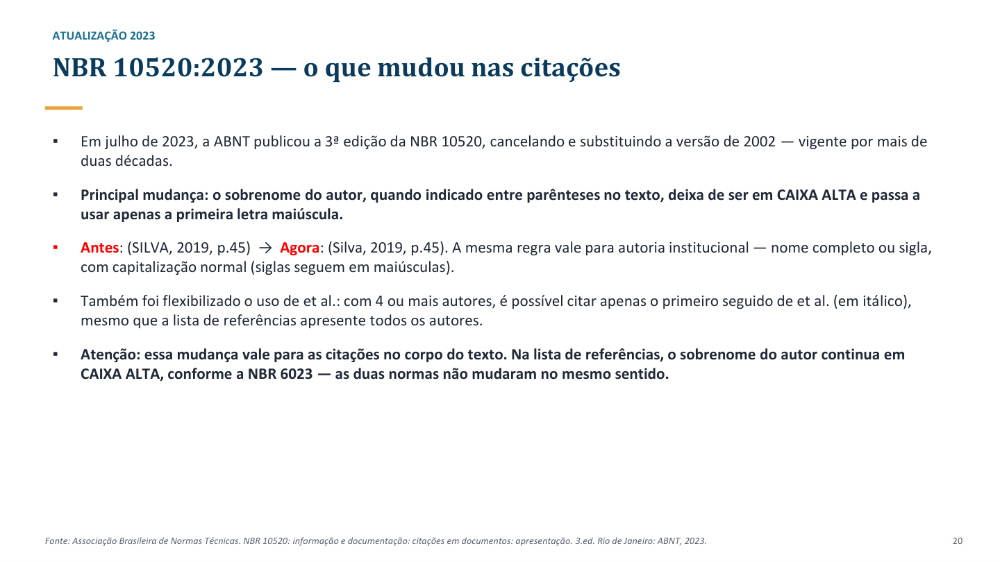

### 00:26:30 — Formatos de referências por tipo de fonte

**Fonte incluída:** [Parte5-TrechosABNT2026.pdf, p. 24](../materiais/Parte5-TrechosABNT2026.pdf#page=24). [Transcrição](../transcricoes/2026-10-30%20-%20Metodologia%20de%20Pesquisa.pt.md).

**Conferência no vídeo:** 00:26:30. Conteúdo do material original comparado ao quadro do vídeo, incluindo textos, números e organização visual.

**Utilidade:** Permite observar negrito, ordem dos elementos e a diferença entre título de artigo, periódico e livro.

**Observação:** Exemplos didáticos de formatação, sem verificação de existência das publicações ilustrativas.

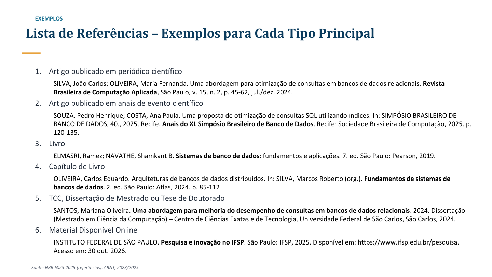

### 00:32:00 — Exemplo de resumo estruturado

**Fonte incluída:** [TCC_DaviAugustodaSilvaRibeiro.pdf, p. 1](../materiais/exemplos/TCC_DaviAugustodaSilvaRibeiro.pdf#page=1). [Transcrição](../transcricoes/2026-10-30%20-%20Metodologia%20de%20Pesquisa.pt.md).

**Conferência no vídeo:** 00:32:00. Conteúdo do material original comparado ao quadro do vídeo, incluindo textos, números e organização visual.

**Utilidade:** Mostra os rótulos e a organização dentro de um parágrafo real de TCC.

**Observação:** O resumo mostrado contém Contexto, Objetivo, Metodologia e Resultados. Na fala, o docente recomenda também Conclusões e esclarece que essa estrutura é uma sugestão.

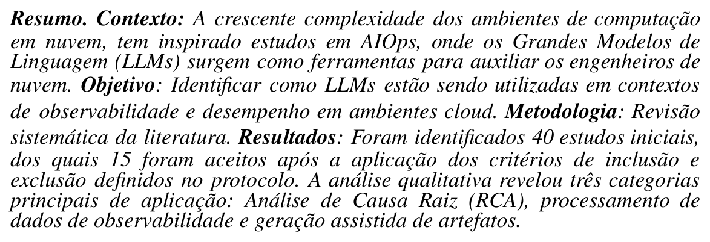

### 00:51:20 — Fluxograma de seleção no TCC de exemplo

**Fonte incluída:** [TCC_MarcosHenriqueMainardiEckart.pdf, p. 4](../materiais/exemplos/TCC_MarcosHenriqueMainardiEckart.pdf#page=4). [Transcrição](../transcricoes/2026-10-30%20-%20Metodologia%20de%20Pesquisa.pt.md).

**Conferência no vídeo:** 00:51:20. Conteúdo do material original comparado ao quadro do vídeo, incluindo textos, números e organização visual.

**Utilidade:** As caixas e setas mostram como relatar seleção, exclusões e conjunto final; o foco é o relato do método, não como buscar artigos.

**Observação:** Números e resultados pertencem ao TCC mostrado. A figura tem 92 identificados e 90 triados sem explicitar nessa tela o motivo da diferença; não copiar números nem tomar o exemplo como protocolo validado.

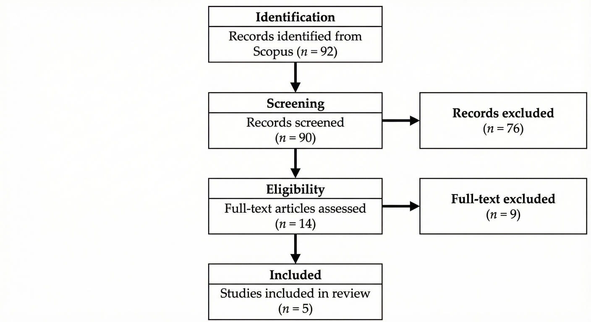

### 00:59:40 — Estrutura sugerida da apresentação

**Fonte incluída:** [Parte6-DicasApresentacao2026.pdf, p. 4](../materiais/Parte6-DicasApresentacao2026.pdf#page=4). [Transcrição](../transcricoes/2026-10-30%20-%20Metodologia%20de%20Pesquisa.pt.md).

**Conferência no vídeo:** 00:59:40. Conteúdo do material original comparado ao quadro do vídeo, incluindo textos, números e organização visual.

**Utilidade:** Reúne em uma tela a sequência de capa, motivação, método, discussão e conclusões.

**Observação:** Embora o slide diga “Apenas 6 slides”, o docente flexibiliza a quantidade na fala. A descrição de obtenção dos estudos deve refletir o método efetivamente adotado pelo aluno.

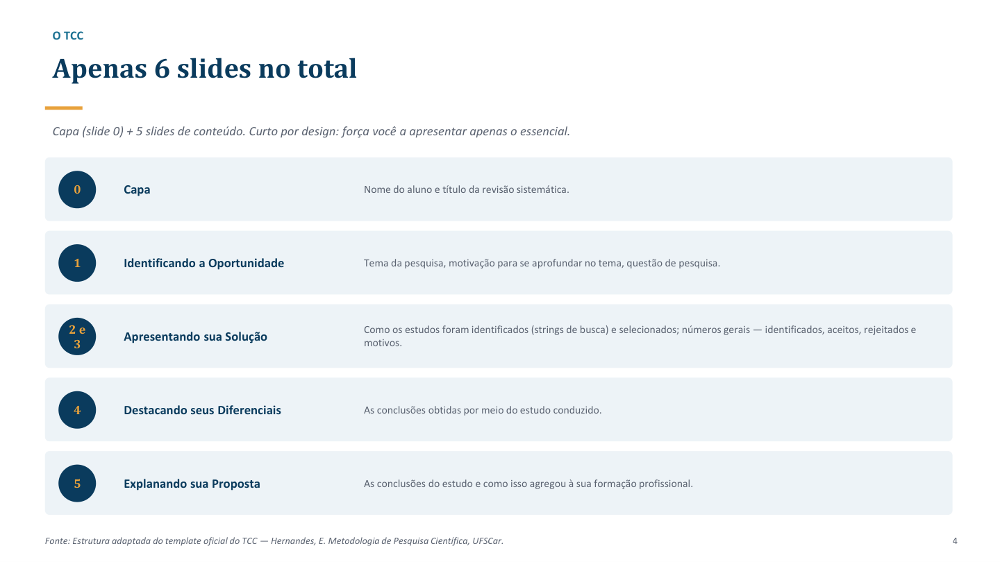

### Trechos úteis que não precisam de imagem

Na [aula de 30/10](../transcricoes/2026-10-30%20-%20Metodologia%20de%20Pesquisa.pt.md), a leitura do texto já atende bem a estes pontos:

- **00:42:03–00:42:48:** distinção feita em aula entre referências de contextualização e estudos utilizados na síntese da revisão.
- **00:44:40–00:47:40:** organização de resultados, agrupamento por assunto e uso de tabelas para reduzir repetição.
- **00:51:39–00:55:07:** responder às questões de pesquisa e articular discussão e conclusão.
- **01:03:01–01:09:45:** síntese nos slides, ensaio e preparação para perguntas da banca.

Esses são registros de orientação em aula, não uma nova checagem de regras, normas ou datas. Em particular, não tratar a entrega para a banca em novembro como a posterior versão final, nem converter a sugestão de seis slides em exigência confirmada.

## Trechos revisados sem imagem equivalente nos arquivos

### 2026-09-19 0756 - Metodologia de Pesquisa - Aula 2 - Parte 1 - Segmento 2.pt.md

Formulários de extração, escalas de qualidade e campo de sumarização demonstrados na StArt. Não foi localizado arquivo .start nem representação equivalente dessas telas nos materiais locais examinados. Parte 3, páginas 23 e 24, oferece apenas apoio conceitual; nenhuma imagem foi inserida como substituto.

**Pontos de conferência no vídeo:** 03:22:40, 03:40:40, 03:42:14. [Transcrição](../transcricoes/2026-09-19%200756%20-%20Metodologia%20de%20Pesquisa%20-%20Aula%202%20-%20Parte%201%20-%20Segmento%202.pt.md).

### 2026-09-19 1333 - Metodologia de Pesquisa - Aula 2 - Parte 2.pt.md

Preenchimento de formulário e visualização de referências na StArt. As páginas 23 e 24 da Parte 3 tratam dos conceitos, mas não reproduzem o formulário nem o grafo mostrado. Sem nova imagem, conforme a preferência por conteúdo equivalente dos arquivos originais.

**Pontos de conferência no vídeo:** 00:10:40, 00:18:00. [Transcrição](../transcricoes/2026-09-19%201333%20-%20Metodologia%20de%20Pesquisa%20-%20Aula%202%20-%20Parte%202.pt.md).

### 2026-10-16 - Metodologia de Pesquisa.pt.md

Nos pontos relevantes examinados, a tela mostra participantes, sem slide ou figura metodológica. O início da gravação contém tutoriais de busca excluídos do escopo; o restante inclui dúvidas e organização dos atendimentos. Nenhuma imagem adicional selecionada.

**Pontos de conferência no vídeo:** 00:12:20, 00:17:20, 00:18:40. [Transcrição](../transcricoes/2026-10-16%20-%20Metodologia%20de%20Pesquisa.pt.md).

## Proveniência e limites

O [manifesto](materiais/manifest.json) registra a cobertura das sete transcrições, as 20 imagens, fontes, páginas, hashes e timestamps. Para os casos sem equivalência, registra os pontos examinados e a decisão de não inserir uma ilustração apenas temática.

A conferência de correspondência visual não valida normas, estatísticas ou recomendações metodológicas citadas na aula. Os exemplos são material didático, e o método da pesquisa do aluno precisa descrever o que ele efetivamente realizar. Os textos transcritos e as saídas originais do Soniox foram preservados.

As antigas imagens de vídeo de 30/10 foram substituídas por reproduções dos documentos. O [registro anterior](2026-10-30/manifest.json) conserva os hashes das capturas removidas e aponta para o manifesto atual. Os recortes do resumo e do fluxograma estão descritos nos respectivos registros do manifesto; os conteúdos não foram reescritos ou redesenhados.
