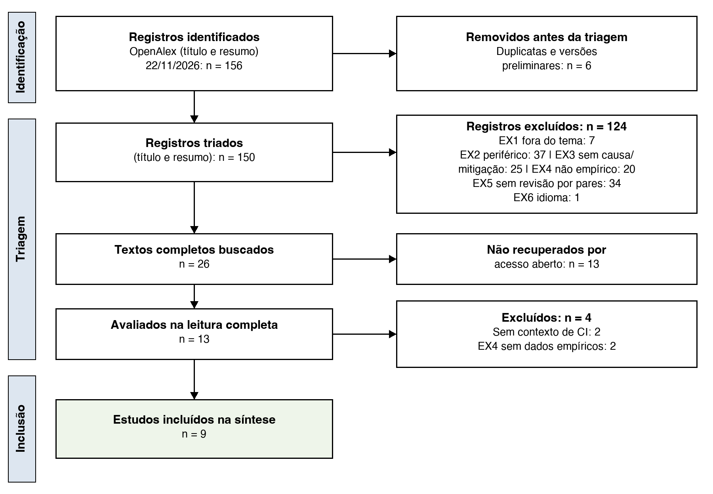

<!-- TCC source (English translation of tcc.md). Generate the DOCX with: python3 build_docx.py tcc-en.md -->
# Causes of and mitigation strategies for flaky tests in continuous integration: a systematic literature review
@autor Gabriel Rodrigues da Silva
@email gabriel.rodrigues47@estudante.ufscar.br

**Abstract.** **Context:** Flaky tests pass and fail without changes to the code and undermine the reliability of continuous integration (CI) *pipelines*. **Objective:** To identify the causes of and mitigation strategies for flaky tests in CI reported in empirical studies, distinguishing evaluated strategies from recommendations. **Method:** A systematic review was conducted using a Scopus search and inclusion and exclusion criteria defined in a protocol. **Results:** A total of 89 records were identified; after the removal of 3 duplicates and screening, 28 studies were selected for full-text reading, 14 were retrieved, and 12 were included. The most recurrent causes lie in the CI execution environment (computational resources, *host* performance, operating system, transient events, and external dependencies), along with causes in the test code, such as *setup/teardown*, asynchronous wait, and concurrency. Rerunning is the most widely adopted strategy, but it is costly; only 5 of the 12 studies evaluate strategies. **Conclusions:** The evidence points to CI infrastructure as a central source of test flakiness and indicates the need for more evaluations of strategies beyond rerunning.

## 1. Introduction

Automated regression tests assume that the outcome of a test depends only on the code under test. Flaky tests violate this assumption: they are tests that can pass and fail without changes to the code (LUO et al., 2014; PARRY et al., 2021). In continuous integration (CI), where every change is verified by an automated *build* that includes tests (FOWLER, 2024), a flaky failure interrupts the *pipeline*, consumes investigation time, and reduces confidence in the results.

Luo et al. (2014) report that, in Google's testing system, 4.56% of daily failures were caused by flaky tests, and that the most common responses, such as rerunning or ignoring the test, were palliative measures that did not address the causes.

The motivation for this work stems from the author's recent professional experience maintaining automated tests in CI, where random failures undermined the reliability of the *pipeline*, and from the software testing courses taken in the especialização (graduate specialization program) at UFSCar (Federal University of São Carlos). Accordingly, this study aims to deepen the understanding of flaky tests in the CI context by answering the question: what causes of and mitigation strategies for flaky tests in the context of continuous integration are reported in empirical studies?

This article is organized as follows: Section 2 presents the concepts of continuous integration and flaky tests; Section 3 describes the research method and its execution; Section 4 presents and discusses the results; and Section 5 presents the conclusions.

## 2. Theoretical background

### 2.1. Continuous integration

Continuous integration is a development practice in which each team member integrates their changes into a shared codebase at least daily, and each integration is verified by an automated *build*, including tests, to detect integration errors as early as possible (FOWLER, 2024).

### 2.2. Flaky tests

A test is considered flaky when it yields both passing and failing results without changes to the code under test (PARRY et al., 2021). Luo et al. (2014) conducted the first extensive study on the topic, analyzing 201 *commits* that likely fixed flaky tests in 51 open-source projects. The three most frequent cause categories were asynchronous wait, concurrency, and test order dependency; the authors also observed that 78% of flaky tests were already flaky when they were written (LUO et al., 2014).

In this work, **cause** refers to the source of nondeterminism that leads a test to fail intermittently, and **mitigation strategy** refers to any action to fix, prevent, or contain the effect of flaky tests. Techniques that only detect or classify flaky tests were not considered mitigation strategies, because detection is generally a step that precedes fixing or containment.

## 3. Research method

The method used was a systematic literature review, conducted according to the guidelines of Kitchenham and Charters (2007), with the reporting of the selection process inspired by PRISMA 2020 (PAGE et al., 2021). The planning was recorded in a protocol.

The research question was: **"What causes of and mitigation strategies for flaky tests in the context of continuous integration are reported in empirical studies?"**, broken down into: (RQ1) which causes are identified; (RQ2) which strategies are used or proposed for these causes; and (RQ3) what evaluation evidence, results, and limitations accompany each strategy.

The search was run in Scopus on November 22, 2026, over the title, abstract, and keyword fields, using the following search *string*: TITLE-ABS-KEY (("flaky test\*" OR "test flakiness" OR "flaky build\*" OR "intermittent test\*" OR "non-deterministic test\*" OR "nondeterministic test\*") AND ("continuous integration" OR "CI")). No year, subject area, or language filters were applied.

### 3.1. Execution – identification and selection of studies

The selection criteria are presented in Table 1. A study was included if it met IN1 or IN2 and none of the exclusion criteria. A study was considered to be in a CI context if its data were collected in CI, if its strategy was applied or evaluated in a CI *pipeline*, or if it had a research question specific to CI; studies that cite CI only as motivation were excluded. Open access was not a selection criterion.

Table 1. Inclusion (IN) and exclusion (EX) criteria
| Code | Criterion |
|---|---|
| IN1 | Empirical primary study that identifies or characterizes causes of flaky tests in a CI context |
| IN2 | Empirical primary study that applies or evaluates a mitigation strategy (fixing, prevention, or containment) in a CI context |
| EX1 | Off-topic (does not address flaky tests in software) |
| EX2 | Flaky tests are only peripheral to another subject (e.g., test selection or prioritization) |
| EX3 | Reports neither causes nor mitigation (exclusive focus on detection, prediction, prevalence, impact, or cost) |
| EX4 | Not an empirical primary study (review, conceptual proposal, or report without data) |
| EX5 | Not published in a peer-reviewed journal or conference |

The search returned 89 records. Three records that were duplicates or preliminary versions of other records were removed, and the remaining 86 underwent title and abstract screening. At this stage, 58 were excluded: 2 under EX1, 24 under EX2, 24 under EX3, and 8 under EX4. Of the 28 studies selected for full-text reading, the full text of 14 was obtained (publisher versions, author versions, institutional repositories, and arXiv), and 14 could not be retrieved for this version of the review. During full-text reading, 2 studies were excluded because their data were not situated in CI (CI appeared only as motivation). Thus, 12 studies were included, as shown in Figure 1.

{11}

### 3.2. Execution – data extraction

For each study read in full, an extraction form recorded: the reference and the version read; the decision and criteria; the context (organization or projects, languages, test types, and CI system); the definition of flaky test adopted; the method and sample; the causes identified; the mitigation strategies, with the causes they address, the status of the evidence (evaluated in the study, observed in practice, or only recommended), the results, and the costs; and the reported limitations. The synthesis was qualitative, with thematic grouping of the causes and strategies.

## 4. Results and discussion

### 4.1. Overview of the included studies

The twelve included studies were published between 2020 and 2026 and are presented in Table 2. Six analyze industrial contexts (Facebook; Google; SAP; Mozilla; five companies in sectors such as sanitation, medical equipment, and automotive; and an unidentified web application), five analyze open-source projects, and one combines a *survey* of developers with an analysis of StackOverflow. The methods include repository mining, controlled experiments, industrial case studies, deployment reports, and *surveys*.

Table 2. Studies included in the review
| ID | Study | Context and method |
|---|---|---|
| E1 | Durieux et al. (2020) | Restarted *builds* on Travis CI; mining of 3.3 million *builds* |
| E2 | Ahmad, Leifler and Sandahl (2021) | Five companies; *survey*, *workshops*, and an interview with practitioners, plus analysis of test artifacts |
| E3 | Ahlgren et al. (2021) | Facebook; deployment of metamorphic testing in CI |
| E4 | Parry et al. (2022) | *Survey* of 170 developers and 38 StackOverflow threads |
| E5 | Henderson et al. (2023) | Google; culprit finding with 13,600 test breakages |
| E6 | Berndt, Bach and Baltes (2024) | SAP HANA; system tests in pre-*submit* CI |
| E7 | Silva et al. (2024) | 52 Java, Python, and JavaScript projects; experiment with 27 resource configurations |
| E8 | Hashemi et al. (2026) | 116 JavaScript projects on GitHub Actions; environment matrix |
| E9 | Xiao et al. (2026) | OpenStack ecosystem (Zuul CI); 649 projects |
| E10 | Kumar (2026) | Selenium suite of 2,400 tests on a Kubernetes grid; nightly runs in production |
| E11 | Leinen, Perathoner and Pretschner (2024) | 232 UI tests from 20 macOS projects run on GitHub Actions; CPU usage monitored |
| E12 | Lampel et al. (2021) | Mozilla; about 2 million CI *job* runs; failure classification and interviews |

### 4.2. Causes of flaky tests in CI (RQ1)

The reported causes were grouped into four categories, presented in Table 3. The most recurrent category, present in all included studies, is the **execution environment and infrastructure**.

Table 3. Cause categories and the studies that report them
| Category | Reported causes | Studies |
|---|---|---|
| CI environment and infrastructure | CPU and memory scarcity; slow *host* and long-running tests; operating system, *runtime* version, and browser; CI service *timeouts* and limits; transient events and virtual machine configuration; differences between local and CI environments; unstable CI server version; stuck execution nodes and parallelism; missing permissions | E1 to E12 |
| Test code and design | Inadequate *setup/teardown*; asynchronous wait; concurrency; dependencies between tests; *sleep* and fixed waits; randomness without a fixed seed; brittle UI selectors | E2, E3, E4, E6, E7, E11 |
| External dependencies and state | Network; unavailable services and *backends*; dependency version updates; mutable external state | E1, E3, E4, E9 |
| Human and process factors | Unclear requirements; lack of experience; old tests not kept up to date; unfamiliarity with the environment | E2 |

In the study by Silva et al. (2024), 46.5% of the detected flaky tests (283 of 608) are sensitive to the availability of computational resources, with CPU being the most influential factor in Java and JavaScript projects and memory in Python projects. In an industrial context, Berndt, Bach and Baltes (2024) find a positive correlation between average test execution time and the flakiness rate (r = 0.74 in the production data and r = 0.79 in the experiment), as well as between lower *host* performance and test flakiness. Contrary to initial hypotheses, infrastructure load showed no correlation, and distributed tests were less flaky than those run on a single machine. Leinen, Perathoner and Pretschner (2024) also qualify the role of resources: on GitHub Actions, runs of flaky tests spent on average 29% of their time at the CPU limit, versus 9% for the other tests, but failing runs spent less time at that limit than passing runs, a result the authors consider contrary to their hypothesis. Hashemi et al. (2026) show that the CI environment matrix itself is a trigger: in 65 of the 116 JavaScript projects analyzed on GitHub Actions, environment-dependent failures occurred, mostly related to the operating system, with Windows accounting for most failures of this type.

In the OpenStack ecosystem, Xiao et al. (2026) coded 110 tests with inconsistent flakiness and attributed 89% of the cases to external or transient events, such as *backend* servers being down and temporarily unavailable resources, followed by dependency and environment configuration issues (21% each). At the *build* level, Durieux et al. (2020) identify test failures as the most frequent cause of restarts, followed by Travis CI limitations (such as *timeout*) and network and dependency installation failures. Kumar (2026) reports that, when a Selenium suite was distributed across 20 nodes, parallelism multiplied infrastructure failures, such as lost browser sessions, out-of-memory nodes, and containers that reported themselves as ready without serving requests. In Mozilla's CI, Lampel et al. (2021) counted 25,871 flaky failures among 38,596 *job* failures; according to the developers interviewed, the most frequent causes were *timeouts* (stemming from network issues, overloaded virtual machines, or unavailable resources) and missing permissions.

Causes in the test code appear mainly in the studies involving developers. In the *survey* by Parry et al. (2022), inadequate *setup/teardown* is the most frequently reported cause, followed by network and unknown causes; asynchronous wait and concurrency rank only fourth and fifth. This ranking diverges from the one observed by Luo et al. (2014) in fix *commits*, possibly because *surveys* measure perception, whereas *commits* record only causes that were fixed. Ahmad, Leifler and Sandahl (2021) add human and process factors perceived by practitioners, such as unclear requirements and the team's lack of experience, which no other included study investigates. Finally, the "unknown cause" category, the third most frequent in the *survey* by Parry et al. (2022), indicates that a substantial share of flaky tests are never diagnosed.

### 4.3. Mitigation strategies and evidence (RQ2 and RQ3)

The identified strategies are presented in Table 4, along with the status of the evidence in each study. Only five studies (E3, E5, E7, E8, and E10) empirically evaluate a strategy; in the others, the strategies are observed practices or the authors' recommendations.

Table 4. Mitigation strategies, causes addressed, and evidence status
| Strategy | Causes addressed | Evidence | Studies |
|---|---|---|---|
| Rerun the test, *job*, or *build* | Any (containment) | Observed, with measured cost | E1, E2, E4, E6, E9, E12 |
| Rerun failures against a redeployed environment and recreate stuck nodes | Infrastructure (containment) | Evaluated | E10 |
| Tolerate test flakiness in culprit finding | Any (containment) | Evaluated | E5 |
| Skip or isolate tests per environment (quarantine) | Operating system, *runtime*, and browser | Evaluated | E8 |
| Size the resources of CI *runners* | Resource scarcity | Evaluated | E7 |
| Isolate external state (*snapshot*) | Mutable external state | Evaluated | E3 |
| Fix the test (wait for a condition, *mocks*, *setup/teardown*, fixed seed) | Test code | Observed | E2, E3, E4, E7 |
| Split long-running tests and set global *timeouts* | Long-running tests and slow *host* | Recommended or observed | E6 |
| Standardize the CI environment and validate dependencies | Configuration and dependencies | Recommended | E8, E9 |
| Repair early and track centrally | Any (process) | Recommended | E4, E9 |

**Rerunning.** Rerunning is the most widely adopted strategy and the best documented in terms of cost. In the *survey* by Parry et al. (2022), rerunning the failed *build* is the most common action, whereas quarantine is the least used. Durieux et al. (2020) observe that 46.77% of *builds* restarted after a failure subsequently pass, but the success rate is lower when the failure is a test failure, and restarts triple the median integration time of *pull requests*, from 16 to 48 hours. At SAP HANA, 500 hours of compute per day are devoted to reruns caused by flaky failures (BERNDT; BACH; BALTES, 2024); in OpenStack, test flakiness accumulated 1,156 days of additional time in code reviews (XIAO et al., 2026); and at Mozilla, manual triage of each flaky failure took 71 minutes on average, with a median of 11 minutes (LAMPEL et al., 2021). OpenStack developers also report that indiscriminate rerunning masked real defects (XIAO et al., 2026). Henderson et al. (2023) show, in Google's CI, that increasing the number of reruns in bisection stabilizes accuracy while cost grows linearly; the proposed Bayesian algorithm, which models the flakiness rate of each test, was more accurate than all bisection variants with reruns. In that study, about 40% of the investigated breakages resulted from flaky failures. Kumar (2026) reruns failures against a fresh deployment of the application and the grid until the set of failures stops changing: the pass rate rose from 75% to 97.3% in two to three rounds, replacing about 36 hours of manual triage. However, a real, intermittent defect would also be discarded as noise, and the study does not report how many runs support these figures.

**Containment through isolation.** Hashemi et al. (2026) propose a tool that, through annotations, skips and logs tests according to the operating system, the Node.js version, or the browser. In the seven projects evaluated, all known environmental failures were contained without false positives or false negatives, allowing the *build* to proceed; however, the test is no longer run in that environment, and execution time increased in some projects. Ahlgren et al. (2021) evaluate the isolation of external state: by running the tests against a precomputed *snapshot* of the social graph instead of the real system, test flakiness dropped from about 50% of the tests in *online* mode to 0% in *offline* mode, with execution an order of magnitude faster, although there is no guarantee that *offline* mode reveals the same defects. The evidence from this study is the weakest in the set (three days of measurement and eight tests).

**Infrastructure.** Silva et al. (2024) evaluate resource sizing: the configuration with 0.5 CPU and 2 GiB of memory was the most cost-effective in the set studied, but the best configuration depends on the project, and increasing resources beyond a certain point brought no significant gain. Of the 14 projects contacted with the suggestion to document minimum resource requirements, 6 responded and 4 changed their project according to the suggestions. Berndt, Bach and Baltes (2024) recommend splitting long-running tests, at the additional cost of environment setup, and report the use of a two-hour global *timeout*; Xiao et al. (2026) report adjustments to concurrency and CI configuration and recommend standardizing environments with containers.

**Fixes and process.** Fixes to the test code appear as observed practices: waiting for a condition instead of using fixed delays, using *mocks*, fixing *setup/teardown*, and isolating shared state (PARRY et al., 2022); controlling the pseudorandom seed and running order-dependent tests sequentially (AHLGREN et al., 2021); and keeping tests small and simple (AHMAD; LEIFLER; SANDAHL, 2021). No included study measures the effect of these fixes in CI. At the process level, recommendations include repairing flaky tests as early as possible (PARRY et al., 2022) and replacing the "rerun and wait" pattern with early intervention and centralized tracking (XIAO et al., 2026).

### 4.4. Discussion

The research question of this study is "what causes of and mitigation strategies for flaky tests in the context of continuous integration are reported in empirical studies?". In light of the results, the answer has three parts. First, in CI, the most documented causes lie in the execution environment (resources, *host*, operating system, network, external services, and configuration), and not only in the test code, as the early taxonomies emphasized (LUO et al., 2014), although the relationship with resource limits is not straightforward (LEINEN; PERATHONER; PRETSCHNER, 2024). Second, the predominant strategy in practice is rerunning, whose cost is well quantified but whose effectiveness is limited and which does not address the cause. Third, the evaluated strategies (per-environment isolation, external-state isolation, resource sizing, rerunning against a redeployed environment, and tolerating test flakiness in culprit finding) act on the environment or on the effect of the failure, whereas fixes to the code, although recommended, were not evaluated in CI by the included studies.

For practice, these results suggest matching the strategy to the cause: environment-related failures are better served by standardizing and sizing the infrastructure; code-related failures are better served by fixes (e.g., setting a fixed seed for random data); and rerunning should be limited and accompanied by logging so as not to hide defects. The costs of the evaluated strategies, such as the additional time of quarantine (HASHEMI et al., 2026) or the loss of realism in *offline* mode (AHLGREN et al., 2021), indicate that there is no one-size-fits-all solution.

This review has limitations. The search used only Scopus and required the term "CI" or "continuous integration" in the title or abstract, which leaves out classic studies that do not mention CI in the abstract. Half of the studies selected for full-text reading (14 of 28) could not be retrieved, and some texts were read in preliminary author versions. The requirement of a CI context tends to favor causes related to the execution environment: the two studies excluded for this reason mainly report causes in the code, such as concurrency and floating-point value comparison. Screening and extraction were performed with AI assistance, without a second independent reviewer. Finally, the studies use different definitions and units of analysis (test, *build*, *job*), which prevents directly summing or comparing their proportions.

## 5. Conclusions

This study reports a systematic review of the causes of and mitigation strategies for flaky tests in continuous integration. Of the 89 records identified in Scopus, 28 were selected for full-text reading, and 12 empirical studies were included, published between 2020 and 2026 in industrial and open-source contexts.

The review found that, in CI, test flakiness stems mainly from the execution environment, such as resource scarcity, *host* performance, operating system differences, and transient infrastructure events, in addition to well-known causes in the test code, such as *setup/teardown*, asynchronous wait, and concurrency. Rerunning is the most common response and has a high, documented cost. Only five studies evaluate strategies, all of them aimed at the environment or at containing the effect of the failure.

Suggested future work includes expanding the search to other databases, such as IEEE Xplore and ACM Digital Library, obtaining the 14 unretrieved texts, and evaluating, in real *pipelines*, the effectiveness of test-code fixes compared with rerunning.

## Statement on the Use of Artificial Intelligence

This work used the Claude assistant (Anthropic), through the Claude Code tool, for the following activities: running the Scopus search through its official API and recording the results; title and abstract screening; retrieving the full texts; filling in the extraction forms; and preparing the flow diagram. The selection decisions, the extracted data, and the final text were reviewed by the author, who is responsible for the content. The search, screening, and extraction records are available for auditing.

## References

::ref AHLGREN, J.; BEREZIN, M. E.; BOJARCZUK, K.; DULSKYTE, E.; DVORTSOVA, I.; GEORGE, J.; GUCEVSKA, N.; HARMAN, M.; LOMELI, M.; MEIJER, E.; SAPORA, S.; SPAHR-SUMMERS, J. Testing web enabled simulation at scale using metamorphic testing. In: INTERNATIONAL CONFERENCE ON SOFTWARE ENGINEERING: SOFTWARE ENGINEERING IN PRACTICE (ICSE-SEIP), 43., 2021, Madrid. **Proceedings** [...]. Piscataway: IEEE, 2021. p. 140-149. DOI: 10.1109/ICSE-SEIP52600.2021.00023.
::ref AHMAD, A.; LEIFLER, O.; SANDAHL, K. Empirical analysis of practitioners' perceptions of test flakiness factors. **Software Testing, Verification and Reliability**, v. 31, n. 8, e1791, 2021. DOI: 10.1002/stvr.1791.
::ref BERNDT, A.; BACH, T.; BALTES, S. Do test and environmental complexity increase flakiness? An empirical study of SAP HANA. In: ACM/IEEE INTERNATIONAL SYMPOSIUM ON EMPIRICAL SOFTWARE ENGINEERING AND MEASUREMENT (ESEM), 18., 2024, Barcelona. **Proceedings** [...]. New York: ACM, 2024. p. 572-581. DOI: 10.1145/3674805.3695407.
::ref DURIEUX, T.; LE GOUES, C.; HILTON, M.; ABREU, R. Empirical study of restarted and flaky builds on Travis CI. In: INTERNATIONAL CONFERENCE ON MINING SOFTWARE REPOSITORIES (MSR), 17., 2020, Seoul. **Proceedings** [...]. New York: ACM, 2020. p. 254-264. DOI: 10.1145/3379597.3387460.
::ref FOWLER, M. **Continuous Integration**. 18 jan. 2024. Disponível em: https://martinfowler.com/articles/continuousIntegration.html. Acesso em: 22 nov. 2026.
::ref HASHEMI, N.; TAHIR, A.; SHI, A.; RASHEED, S.; BLAGOJEVIC, R. A systematic evaluation of environmental flakiness in JavaScript tests. In: IEEE INTERNATIONAL CONFERENCE ON SOFTWARE TESTING, VERIFICATION AND VALIDATION (ICST), 2026. **Proceedings** [...]. Piscataway: IEEE, 2026. p. 105-116. DOI: 10.1109/ICST69053.2026.00025.
::ref HENDERSON, T. A. D.; DORWARD, B.; NICKELL, E.; JOHNSTON, C.; KONDAREDDY, A. Flake aware culprit finding. In: IEEE CONFERENCE ON SOFTWARE TESTING, VERIFICATION AND VALIDATION (ICST), 2023, Dublin. **Proceedings** [...]. Piscataway: IEEE, 2023. p. 362-373. DOI: 10.1109/ICST57152.2023.00041.
::ref KITCHENHAM, B.; CHARTERS, S. **Guidelines for performing systematic literature reviews in software engineering**. Keele: Keele University; Durham: Durham University, 2007. (Technical Report EBSE-2007-01).
::ref KUMAR, S. Bounded self-correction in distributed test infrastructure: a self-healing Selenium grid on Kubernetes. **Journal of Intelligent Decision Making and Information Science**, v. 3, n. 8s, p. 299-310, 2026. DOI: 10.59543/jidmis.v3.2033.
::ref LAMPEL, J.; JUST, S.; APEL, S.; ZELLER, A. When life gives you oranges: detecting and diagnosing intermittent job failures at Mozilla. In: ACM JOINT EUROPEAN SOFTWARE ENGINEERING CONFERENCE AND SYMPOSIUM ON THE FOUNDATIONS OF SOFTWARE ENGINEERING (ESEC/FSE), 29., 2021, Athens. **Proceedings** [...]. New York: ACM, 2021. p. 1381-1392. DOI: 10.1145/3468264.3473931.
::ref LEINEN, F.; PERATHONER, A.; PRETSCHNER, A. On the impact of hitting system resource limits on test flakiness. In: INTERNATIONAL FLAKY TESTS WORKSHOP (FTW), 2024, Lisbon. **Proceedings** [...]. New York: ACM, 2024. DOI: 10.1145/3643656.3643898.
::ref LUO, Q.; HARIRI, F.; ELOUSSI, L.; MARINOV, D. An empirical analysis of flaky tests. In: ACM SIGSOFT INTERNATIONAL SYMPOSIUM ON FOUNDATIONS OF SOFTWARE ENGINEERING (FSE), 22., 2014, Hong Kong. **Proceedings** [...]. New York: ACM, 2014. p. 643-653. DOI: 10.1145/2635868.2635920.
::ref PAGE, M. J. et al. The PRISMA 2020 statement: an updated guideline for reporting systematic reviews. **BMJ**, v. 372, n71, 2021. DOI: 10.1136/bmj.n71.
::ref PARRY, O.; KAPFHAMMER, G. M.; HILTON, M.; MCMINN, P. A survey of flaky tests. **ACM Transactions on Software Engineering and Methodology**, v. 31, n. 1, p. 1-74, 2021. DOI: 10.1145/3476105.
::ref PARRY, O.; KAPFHAMMER, G. M.; HILTON, M.; MCMINN, P. Surveying the developer experience of flaky tests. In: INTERNATIONAL CONFERENCE ON SOFTWARE ENGINEERING: SOFTWARE ENGINEERING IN PRACTICE (ICSE-SEIP), 44., 2022, Pittsburgh. **Proceedings** [...]. New York: ACM, 2022. p. 253-262. DOI: 10.1145/3510457.3513037.
::ref SILVA, D.; GRUBER, M.; GOKHALE, S.; ARTECA, E.; TURCOTTE, A.; D'AMORIM, M.; LAM, W.; WINTER, S.; BELL, J. The effects of computational resources on flaky tests. **IEEE Transactions on Software Engineering**, v. 50, n. 12, p. 3104-3121, 2024. DOI: 10.1109/TSE.2024.3462251.
::ref XIAO, T.; WANG, D.; MCINTOSH, S.; HATA, H.; KAMEI, Y. Cross-project flakiness: a case study of the OpenStack ecosystem. **IEEE Transactions on Software Engineering**, v. 52, n. 6, p. 1875-1890, 2026. DOI: 10.1109/TSE.2026.3685588.
