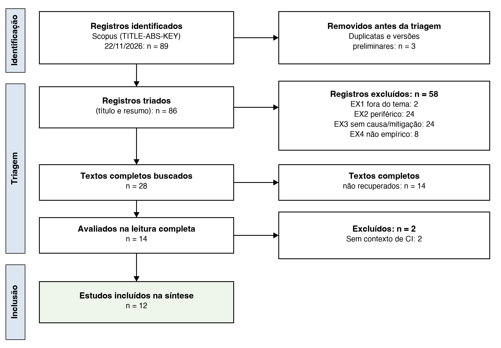

<!-- Fonte do TCC. Gere o DOCX com: python3 build_docx.py -->
<!-- RASCUNHO preparado com apoio de IA em 22/11/2026. Todo conteúdo deve ser revisado pelo aluno. -->
# Causas e estratégias de mitigação de testes intermitentes em integração contínua: uma revisão sistemática da literatura
@autor Gabriel Rodrigues da Silva
@email gabriel.rodrigues47@estudante.ufscar.br

**Resumo.** **Contexto:** testes intermitentes (*flaky tests*) passam e falham sem alteração no código e comprometem a confiabilidade dos *pipelines* de integração contínua (CI). **Objetivo:** identificar as causas e as estratégias de mitigação de testes intermitentes em CI relatadas em estudos empíricos, distinguindo estratégias avaliadas de recomendações. **Metodologia:** foi conduzida uma revisão sistemática com busca na Scopus e critérios de inclusão e exclusão definidos em protocolo. **Resultados:** 89 registros foram identificados; após a remoção de 3 duplicatas e a triagem, 28 estudos foram selecionados para leitura completa, 14 foram recuperados e 12 foram incluídos. As causas mais recorrentes estão no ambiente de execução da CI (recursos computacionais, desempenho do *host*, sistema operacional, eventos transitórios e dependências externas), além de causas no código de teste, como *setup/teardown*, espera assíncrona e concorrência. A reexecução é a estratégia mais adotada, mas tem custo elevado; apenas 5 dos 12 estudos avaliam estratégias. **Conclusões:** a evidência aponta a infraestrutura de CI como fonte central de intermitência e indica a necessidade de mais avaliações de estratégias além da reexecução.

## 1. Introdução

Testes automatizados de regressão pressupõem que o resultado de um teste dependa apenas do código sob teste. Testes intermitentes violam esse pressuposto: são testes que podem passar e falhar sem mudanças no código (LUO et al., 2014; PARRY et al., 2021). Na integração contínua (CI, do inglês *Continuous Integration*), em que cada mudança é verificada por um *build* automatizado com testes (FOWLER, 2024), uma falha intermitente interrompe o *pipeline*, consome tempo de investigação e reduz a confiança nos resultados.

Luo et al. (2014) relatam que, no sistema de testes da Google, 4,56% das falhas diárias eram causadas por testes intermitentes, e que as respostas mais comuns, como reexecutar ou ignorar o teste, eram paliativos que não tratavam as causas.

A motivação deste trabalho vem da prática profissional do autor com a manutenção de testes automatizados em CI, em que falhas aleatórias associadas a dados de teste gerados aleatoriamente comprometiam a confiabilidade do *pipeline*. Sendo assim, este estudo tem como objetivo aprofundar os conhecimentos sobre testes intermitentes no contexto de CI, respondendo à questão: quais causas e estratégias de mitigação de testes intermitentes no contexto de integração contínua são relatadas em estudos empíricos?

Este artigo está organizado da seguinte forma: na Seção 2 são apresentados os conceitos de integração contínua e de testes intermitentes; na Seção 3 é descrito o método de pesquisa e sua execução; na Seção 4 são apresentados e discutidos os resultados; por fim, na Seção 5, são apresentadas as conclusões.

## 2. Fundamentação teórica

### 2.1. Integração contínua

Integração contínua é a prática de desenvolvimento em que cada membro da equipe integra suas alterações a uma base de código comum, ao menos diariamente, e cada integração é verificada por um *build* automatizado, incluindo testes, para detectar erros de integração o mais cedo possível (FOWLER, 2024).

### 2.2. Testes intermitentes

Um teste é considerado intermitente (*flaky*) quando apresenta resultados de aprovação e falha sem alterações no código sob teste (PARRY et al., 2021). Luo et al. (2014) realizaram o primeiro estudo extenso sobre o tema, analisando 201 *commits* que provavelmente corrigiam testes intermitentes em 51 projetos de código aberto. As três categorias de causa mais frequentes foram espera assíncrona (*async wait*), concorrência e dependência da ordem de execução dos testes; os autores também observaram que 78% dos testes intermitentes já eram intermitentes quando foram escritos (LUO et al., 2014).

Neste trabalho, **causa** designa a fonte de não determinismo que leva o teste a falhar de forma intermitente, e **estratégia de mitigação** designa qualquer ação para corrigir, prevenir ou conter o efeito dos testes intermitentes. Técnicas que apenas detectam ou classificam testes intermitentes não foram consideradas estratégias de mitigação, pois a detecção é, em geral, uma etapa anterior à correção ou à contenção.

## 3. Método de pesquisa

O método utilizado foi a revisão sistemática da literatura, conduzida segundo as diretrizes de Kitchenham e Charters (2007), com relato do processo de seleção inspirado no PRISMA 2020 (PAGE et al., 2021). O planejamento foi registrado em protocolo.

A questão de pesquisa foi: **"Quais causas e estratégias de mitigação de testes intermitentes no contexto de integração contínua são relatadas em estudos empíricos?"**, desdobrada em: (QP1) quais causas são identificadas; (QP2) quais estratégias são utilizadas ou propostas para essas causas; e (QP3) que evidências de avaliação, resultados e limitações acompanham cada estratégia.

A busca foi executada em 22/11/2026 na Scopus, nos campos de título, resumo e palavras-chave, com a seguinte *string*: TITLE-ABS-KEY (("flaky test\*" OR "test flakiness" OR "flaky build\*" OR "intermittent test\*" OR "non-deterministic test\*" OR "nondeterministic test\*") AND ("continuous integration" OR "CI")). Não foram aplicados filtros de ano, área ou idioma.

### 3.1. Execução – identificação e seleção dos estudos

Os critérios de seleção são apresentados na Tabela 1. Um estudo foi incluído quando atendeu a IN1 ou IN2 e a nenhum critério de exclusão. Considerou-se em contexto de CI o estudo cujos dados foram coletados em CI, cuja estratégia foi aplicada ou avaliada em um *pipeline* de CI ou que tem questão de pesquisa específica sobre CI; estudos que citam a CI apenas como motivação foram excluídos. O acesso aberto não foi critério de seleção.

Tabela 1. Critérios de inclusão (IN) e de exclusão (EX)
| Código | Critério |
|---|---|
| IN1 | Estudo primário empírico que identifica ou caracteriza causas de testes intermitentes em contexto de CI |
| IN2 | Estudo primário empírico que aplica ou avalia estratégia de mitigação (correção, prevenção ou contenção) em contexto de CI |
| EX1 | Fora do tema (não trata de testes intermitentes de software) |
| EX2 | Testes intermitentes apenas periféricos a outro objeto (por exemplo, seleção ou priorização de testes) |
| EX3 | Não relata causas nem mitigação (foco exclusivo em detecção, predição, prevalência, impacto ou custo) |
| EX4 | Não é estudo primário empírico (revisão, proposta conceitual ou relato sem dados) |
| EX5 | Não publicado em periódico ou conferência com revisão por pares |

A busca retornou 89 registros. Foram removidos 3 registros duplicados ou versões preliminares de outros registros, e os 86 restantes foram triados por título e resumo. Nessa etapa, 58 foram excluídos: 2 por EX1, 24 por EX2, 24 por EX3 e 8 por EX4. Dos 28 estudos selecionados para leitura completa, 14 tiveram o texto obtido (versões da editora, dos autores, de repositórios institucionais e do arXiv) e 14 não puderam ser recuperados nesta versão. Na leitura completa, 2 estudos foram excluídos por não situarem os dados em CI (a CI aparecia apenas como motivação). Assim, 12 estudos foram incluídos, como apresentado na Figura 1.

{11}

### 3.2. Execução – extração dos dados

Para cada estudo lido integralmente, um formulário registrou: referência e versão lida; decisão e critérios; contexto (organização ou projetos, linguagens, tipos de teste e sistema de CI); definição de teste intermitente adotada; método e amostra; causas identificadas; estratégias de mitigação, com as causas que tratam, a situação da evidência (avaliada no estudo, observada na prática ou apenas recomendada), os resultados e os custos; e as limitações relatadas. A síntese foi qualitativa, com agrupamento temático das causas e das estratégias.

## 4. Resultados e discussões

### 4.1. Visão geral dos estudos incluídos

Os doze estudos incluídos foram publicados entre 2020 e 2026 e são apresentados na Tabela 2. Seis analisam contextos industriais (Facebook, Google, SAP, Mozilla, cinco empresas de setores como saneamento, equipamentos médicos e automotivo, e uma aplicação web não identificada), cinco analisam projetos de código aberto e um combina um *survey* com desenvolvedores e a análise do StackOverflow. Os métodos incluem mineração de repositórios, experimentos controlados, estudos de caso industriais, relatos de implantação e *surveys*.

Tabela 2. Estudos incluídos na revisão
| ID | Estudo | Contexto e método |
|---|---|---|
| E1 | Durieux et al. (2020) | *Builds* reiniciados no Travis CI; mineração de 3,3 milhões de *builds* |
| E2 | Ahmad, Leifler e Sandahl (2021) | Cinco empresas; *survey*, *workshops* e entrevista com praticantes e análise de artefatos de teste |
| E3 | Ahlgren et al. (2021) | Facebook; implantação de testes metamórficos na CI |
| E4 | Parry et al. (2022) | *Survey* com 170 desenvolvedores e 38 tópicos do StackOverflow |
| E5 | Henderson et al. (2023) | Google; localização de *commits* culpados com 13.600 quebras de teste |
| E6 | Berndt, Bach e Baltes (2024) | SAP HANA; testes de sistema no CI pré-*submit* |
| E7 | Silva et al. (2024) | 52 projetos Java, Python e JavaScript; experimento com 27 configurações de recursos |
| E8 | Hashemi et al. (2026) | 116 projetos JavaScript no GitHub Actions; matriz de ambientes |
| E9 | Xiao et al. (2026) | Ecossistema OpenStack (Zuul CI); 649 projetos |
| E10 | Kumar (2026) | Suíte Selenium de 2.400 testes em grade Kubernetes; execuções noturnas em produção |
| E11 | Leinen, Perathoner e Pretschner (2024) | 232 testes de interface de 20 projetos macOS executados no GitHub Actions; uso de CPU monitorado |
| E12 | Lampel et al. (2021) | Mozilla; cerca de 2 milhões de execuções de *jobs* de CI; classificação de falhas e entrevistas |

### 4.2. Causas de testes intermitentes em CI (QP1)

As causas relatadas foram agrupadas em quatro categorias, apresentadas na Tabela 3. A categoria mais recorrente, presente em todos os estudos incluídos, é o **ambiente e a infraestrutura de execução**.

Tabela 3. Categorias de causa e estudos que as relatam
| Categoria | Causas relatadas | Estudos |
|---|---|---|
| Ambiente e infraestrutura de CI | Escassez de CPU e memória; *host* lento e testes longos; sistema operacional, versão do *runtime* e navegador; *timeouts* e limites do serviço de CI; eventos transitórios e configuração de máquinas virtuais; diferenças entre ambiente local e CI; versão instável do servidor de CI; nós de execução travados e paralelismo; permissões ausentes | E1 a E12 |
| Código e projeto do teste | *Setup/teardown* inadequado; espera assíncrona; concorrência; dependência entre testes; *sleep* e esperas fixas; aleatoriedade sem semente fixa; seletores de interface frágeis | E2, E3, E4, E6, E7, E11 |
| Dependências e estado externos | Rede; serviços e *backends* fora do ar; atualização de versões de dependências; estado externo mutável | E1, E3, E4, E9 |
| Fatores humanos e de processo | Requisitos pouco claros; falta de experiência; testes antigos não atualizados; desconhecimento do ambiente | E2 |

No estudo de Silva et al. (2024), 46,5% dos testes intermitentes detectados (283 de 608) são sensíveis à disponibilidade de recursos computacionais, com a CPU como fator mais influente em projetos Java e JavaScript e a memória em projetos Python. Em um contexto industrial, Berndt, Bach e Baltes (2024) encontram correlação positiva entre o tempo médio de execução dos testes e a taxa de intermitência (r = 0,74 nos dados de produção e r = 0,79 no experimento) e entre o desempenho mais baixo do *host* e a intermitência; contrariando hipóteses iniciais, a carga da infraestrutura não apresentou correlação, e testes distribuídos foram menos intermitentes que os executados em uma única máquina. Leinen, Perathoner e Pretschner (2024) também relativizam o papel dos recursos: no GitHub Actions, execuções de testes intermitentes passaram em média 29% do tempo no limite de CPU, contra 9% nos demais, mas as execuções que falharam passaram menos tempo nesse limite que as que passaram, resultado que os autores consideram contrário à sua hipótese. Hashemi et al. (2026) mostram que a própria matriz de ambientes da CI é um gatilho: em 65 dos 116 projetos JavaScript analisados no GitHub Actions houve falhas dependentes de ambiente, sobretudo de sistema operacional, com o Windows concentrando a maior parte das falhas desse tipo.

No ecossistema OpenStack, Xiao et al. (2026) codificaram 110 testes com intermitência inconsistente e atribuíram 89% dos casos a eventos externos ou transitórios, como servidores de *backend* fora do ar e recursos temporariamente indisponíveis, seguidos de problemas de dependências e de configuração do ambiente (21% cada). No nível do *build*, Durieux et al. (2020) identificam as falhas de teste como a causa mais frequente de reinício, seguidas de limitações do Travis CI (como *timeout*) e de falhas de rede e de instalação de dependências. Kumar (2026) relata que, ao distribuir uma suíte Selenium em 20 nós, o paralelismo multiplicou as falhas de infraestrutura, como sessões de navegador perdidas, falta de memória nos nós e contêineres que se declaravam prontos sem atender requisições. No CI da Mozilla, Lampel et al. (2021) contaram 25.871 falhas intermitentes entre 38.596 falhas de *jobs*; segundo os desenvolvedores entrevistados, as causas mais frequentes eram *timeouts*, decorrentes de rede, máquinas virtuais sobrecarregadas ou recursos indisponíveis, e permissões ausentes.

As causas no código do teste aparecem principalmente nos estudos com desenvolvedores. No *survey* de Parry et al. (2022), *setup/teardown* inadequado é a causa relatada com maior frequência, seguida de rede e de causas desconhecidas; espera assíncrona e concorrência ocupam apenas a quarta e a quinta posições. Essa ordem diverge da observada por Luo et al. (2014) em *commits* de correção, possivelmente porque *surveys* medem percepção, enquanto *commits* registram apenas causas corrigidas. Ahmad, Leifler e Sandahl (2021) acrescentam fatores humanos e de processo percebidos por praticantes, como requisitos pouco claros e falta de experiência da equipe, que nenhum outro estudo incluído investiga. Por fim, a categoria "causa desconhecida", terceira mais frequente no *survey* de Parry et al. (2022), indica que uma parcela relevante dos testes intermitentes nunca chega a ser diagnosticada.

### 4.3. Estratégias de mitigação e evidências (QP2 e QP3)

As estratégias identificadas são apresentadas na Tabela 4, com a situação da evidência em cada estudo. Apenas cinco estudos (E3, E5, E7, E8 e E10) avaliam empiricamente uma estratégia; nos demais, as estratégias são práticas observadas ou recomendações dos autores.

Tabela 4. Estratégias de mitigação, causas tratadas e situação da evidência
| Estratégia | Causas tratadas | Evidência | Estudos |
|---|---|---|---|
| Reexecutar o teste, o *job* ou o *build* | Qualquer (contenção) | Observada, com custo medido | E1, E2, E4, E6, E9, E12 |
| Reexecutar falhas contra ambiente reimplantado e recriar nós travados | Infraestrutura (contenção) | Avaliada | E10 |
| Tolerar a intermitência na localização do *commit* culpado | Qualquer (contenção) | Avaliada | E5 |
| Pular ou isolar testes por ambiente (quarentena) | Sistema operacional, *runtime* e navegador | Avaliada | E8 |
| Dimensionar os recursos dos *runners* de CI | Escassez de recursos | Avaliada | E7 |
| Isolar o estado externo (*snapshot*) | Estado externo mutável | Avaliada | E3 |
| Corrigir o teste (esperar por condição, *mocks*, *setup/teardown*, semente fixa) | Código do teste | Observada | E2, E3, E4, E7 |
| Dividir testes longos e definir *timeouts* globais | Testes longos e *host* lento | Recomendada ou observada | E6 |
| Padronizar o ambiente de CI e validar dependências | Configuração e dependências | Recomendada | E8, E9 |
| Reparar cedo e rastrear centralmente | Qualquer (processo) | Recomendada | E4, E9 |

**Reexecução.** É a estratégia mais adotada e a mais bem documentada quanto ao custo. No *survey* de Parry et al. (2022), reexecutar o *build* que falhou é a ação mais comum, enquanto a quarentena é a menos usada. Durieux et al. (2020) observam que 46,77% dos *builds* reiniciados após falha passam a ser aprovados, mas a taxa de sucesso é menor quando a falha é de teste, e os reinícios triplicam o tempo mediano de integração de *pull requests*, de 16 para 48 horas. No SAP HANA, 500 horas diárias de computação são dedicadas a reexecuções causadas por falhas intermitentes (BERNDT; BACH; BALTES, 2024), no OpenStack a intermitência acumulou 1.156 dias de tempo adicional em revisões de código (XIAO et al., 2026), e na Mozilla a triagem manual de cada falha intermitente levou em média 71 minutos, com mediana de 11 minutos (LAMPEL et al., 2021). Desenvolvedores do OpenStack relatam, ainda, que a reexecução indiscriminada mascarou defeitos reais (XIAO et al., 2026). Henderson et al. (2023) mostram, no CI da Google, que aumentar o número de reexecuções na bisseção estabiliza a acurácia enquanto o custo cresce linearmente; o algoritmo bayesiano proposto, que modela a taxa de intermitência de cada teste, foi mais preciso que todas as variantes de bisseção com reexecuções. Nesse estudo, cerca de 40% das quebras investigadas decorriam de falhas intermitentes. Kumar (2026) reexecuta as falhas contra uma nova implantação da aplicação e da grade até que o conjunto de falhas pare de mudar: a taxa de aprovação passou de 75% para 97,3% em duas a três rodadas, substituindo cerca de 36 horas de triagem manual. Porém, um defeito real e intermitente também seria descartado como ruído, e o estudo não informa quantas execuções sustentam os números.

**Contenção por isolamento.** Hashemi et al. (2026) propõem uma ferramenta que pula e registra testes conforme o sistema operacional, a versão do Node.js ou o navegador, por meio de anotações. Nos sete projetos avaliados, todas as falhas ambientais conhecidas foram contidas sem falsos positivos ou negativos, permitindo que o *build* prosseguisse; o teste, porém, deixa de ser executado naquele ambiente, e o tempo de execução aumentou em alguns projetos. Ahlgren et al. (2021) avaliam o isolamento do estado externo: ao executar os testes sobre um *snapshot* pré-computado do grafo social, em vez do sistema real, a intermitência caiu de cerca de 50% dos testes no modo *online* para 0% no modo *offline*, com execução uma ordem de grandeza mais rápida, embora sem garantia de que o modo *offline* revele os mesmos defeitos. A evidência desse estudo é a mais frágil do conjunto (três dias de medição e oito testes).

**Infraestrutura.** Silva et al. (2024) avaliam o dimensionamento de recursos: a configuração com 0,5 CPU e 2 GiB de memória foi a mais custo-efetiva no conjunto estudado, mas a melhor configuração depende do projeto, e aumentar os recursos além de certo ponto não trouxe ganho significativo. Dos 14 projetos contatados com a sugestão de documentar requisitos mínimos de recursos, 6 responderam e 4 alteraram o projeto conforme as sugestões. Berndt, Bach e Baltes (2024) recomendam dividir testes longos, a um custo adicional de preparação do ambiente, e relatam o uso de um *timeout* global de duas horas; Xiao et al. (2026) relatam ajustes de concorrência e de configuração da CI e recomendam padronizar ambientes com contêineres.

**Correção e processo.** As correções no código do teste aparecem como práticas observadas: esperar por uma condição em vez de usar atrasos fixos, usar *mocks*, corrigir *setup/teardown* e isolar estado compartilhado (PARRY et al., 2022); controlar a semente pseudoaleatória e executar em sequência os testes dependentes de ordem (AHLGREN et al., 2021); manter testes pequenos e simples (AHMAD; LEIFLER; SANDAHL, 2021). Nenhum estudo incluído mede o efeito dessas correções em CI. No plano do processo, recomenda-se reparar os testes intermitentes o quanto antes (PARRY et al., 2022) e substituir o padrão de "reexecutar e esperar" por intervenção precoce e rastreamento centralizado (XIAO et al., 2026).

### 4.4. Discussão

A questão de pesquisa deste estudo é "quais causas e estratégias de mitigação de testes intermitentes no contexto de integração contínua são relatadas em estudos empíricos?". Observados os resultados, a resposta tem três partes. Primeiro, em CI, as causas mais documentadas estão no ambiente de execução (recursos, *host*, sistema operacional, rede, serviços externos e configuração), embora a relação com os limites de recursos não seja direta (LEINEN; PERATHONER; PRETSCHNER, 2024), e não apenas no código do teste, como enfatizavam as taxonomias iniciais (LUO et al., 2014). Segundo, a estratégia predominante na prática é a reexecução, cujo custo é bem quantificado, mas cuja efetividade é limitada e que não trata a causa. Terceiro, as estratégias avaliadas (isolamento por ambiente, isolamento do estado externo, dimensionamento de recursos, reexecução contra ambiente reimplantado e tolerância à intermitência na localização de culpados) atuam sobre o ambiente ou sobre o efeito da falha, enquanto as correções no código, embora recomendadas, não foram avaliadas em CI pelos estudos incluídos.

Para a prática, esses resultados sugerem relacionar a estratégia à causa: falhas de ambiente favorecem padronização e dimensionamento da infraestrutura; falhas de código favorecem correção (por exemplo, fixar a semente de dados aleatórios, situação que motivou este trabalho); e a reexecução deve ser limitada e acompanhada de registro, para não ocultar defeitos. Os custos das estratégias avaliadas, como o tempo adicional da quarentena (HASHEMI et al., 2026) ou a perda de realismo do modo *offline* (AHLGREN et al., 2021), indicam que não há solução única.

Esta revisão tem limitações. A busca usou apenas a Scopus e exigiu o termo "CI" ou "continuous integration" no título ou no resumo, o que deixa de fora estudos clássicos que não mencionam CI no resumo. Metade dos estudos selecionados para leitura completa (14 de 28) não pôde ser recuperada, e alguns textos foram lidos em versões preliminares dos autores. A exigência de contexto de CI tende a favorecer causas ligadas ao ambiente de execução: os dois estudos excluídos por esse motivo relatam sobretudo causas no código, como concorrência e comparação de valores de ponto flutuante. A triagem e a extração foram realizadas com apoio de IA, sem um segundo revisor independente. Por fim, os estudos usam definições e unidades de análise diferentes (teste, *build*, *job*), o que impede somar ou comparar diretamente suas proporções.

## 5. Conclusões

Este estudo relata uma revisão sistemática sobre as causas e as estratégias de mitigação de testes intermitentes em integração contínua. Dos 89 registros identificados na Scopus, 28 foram selecionados para leitura completa e 12 estudos empíricos foram incluídos, publicados entre 2020 e 2026, em contextos industriais e de código aberto.

Foi possível identificar que, em CI, a intermitência decorre sobretudo do ambiente de execução, como a escassez de recursos, o desempenho do *host*, as diferenças de sistema operacional e os eventos transitórios de infraestrutura, além de causas conhecidas no código do teste, como *setup/teardown*, espera assíncrona e concorrência. A reexecução é a resposta mais comum e tem custo elevado e documentado. Apenas cinco estudos avaliam estratégias, todas voltadas ao ambiente ou à contenção do efeito da falha.

Como trabalhos futuros, sugere-se ampliar a busca para outras bases, como IEEE Xplore e ACM Digital Library, obter os 14 textos não recuperados e avaliar, em *pipelines* reais, a efetividade das correções no código do teste em comparação com a reexecução.

## Declaração de Uso de Inteligência Artificial

Este trabalho utilizou o assistente Claude (Anthropic), por meio da ferramenta Claude Code, nas seguintes atividades: execução da busca na Scopus, por meio de sua interface de programação, e registro dos resultados; triagem por título e resumo; recuperação dos textos completos; leitura completa e preenchimento dos formulários de extração; elaboração do fluxograma; e redação da versão preliminar deste artigo. As decisões de seleção, os dados extraídos e o texto final foram revisados pelo autor, que é responsável pelo conteúdo. Os registros da busca, da triagem e da extração estão disponíveis para auditoria.

## Referências

::ref AHLGREN, J.; BEREZIN, M. E.; BOJARCZUK, K.; DULSKYTE, E.; DVORTSOVA, I.; GEORGE, J.; GUCEVSKA, N.; HARMAN, M.; LOMELI, M.; MEIJER, E.; SAPORA, S.; SPAHR-SUMMERS, J. Testing web enabled simulation at scale using metamorphic testing. In: INTERNATIONAL CONFERENCE ON SOFTWARE ENGINEERING: SOFTWARE ENGINEERING IN PRACTICE (ICSE-SEIP), 43., 2021, Madrid. **Proceedings** [...]. Piscataway: IEEE, 2021. p. 140-149. DOI: 10.1109/ICSE-SEIP52600.2021.00023.
::ref AHMAD, A.; LEIFLER, O.; SANDAHL, K. Empirical analysis of practitioners' perceptions of test flakiness factors. **Software Testing, Verification and Reliability**, v. 31, n. 8, e1791, 2021. DOI: 10.1002/stvr.1791.
::ref BERNDT, A.; BACH, T.; BALTES, S. Do test and environmental complexity increase flakiness? An empirical study of SAP HANA. In: ACM/IEEE INTERNATIONAL SYMPOSIUM ON EMPIRICAL SOFTWARE ENGINEERING AND MEASUREMENT (ESEM), 18., 2024, Barcelona. **Proceedings** [...]. New York: ACM, 2024. p. 572-581. DOI: 10.1145/3674805.3695407.
::ref DURIEUX, T.; LE GOUES, C.; HILTON, M.; ABREU, R. Empirical study of restarted and flaky builds on Travis CI. In: INTERNATIONAL CONFERENCE ON MINING SOFTWARE REPOSITORIES (MSR), 17., 2020, Seoul. **Proceedings** [...]. New York: ACM, 2020. p. 254-264. DOI: 10.1145/3379597.3387460.
::ref FOWLER, M. **Continuous Integration**. 18 jan. 2024. Disponível em: https://martinfowler.com/articles/continuousIntegration.html. Acesso em: 22 nov. 2026.
::ref HASHEMI, N.; TAHIR, A.; SHI, A.; RASHEED, S.; BLAGOJEVIC, R. A systematic evaluation of environmental flakiness in JavaScript tests. In: IEEE INTERNATIONAL CONFERENCE ON SOFTWARE TESTING, VERIFICATION AND VALIDATION (ICST), 2026. **Proceedings** [...]. Piscataway: IEEE, 2026. p. 105-116. DOI: 10.1109/ICST69053.2026.00025.
::ref HENDERSON, T. A. D.; DORWARD, B.; NICKELL, E.; JOHNSTON, C.; KONDAREDDY, A. Flake aware culprit finding. In: IEEE CONFERENCE ON SOFTWARE TESTING, VERIFICATION AND VALIDATION (ICST), 2023, Dublin. **Proceedings** [...]. Piscataway: IEEE, 2023. p. 362-373. DOI: 10.1109/ICST57152.2023.00041.
::ref KITCHENHAM, B.; CHARTERS, S. **Guidelines for performing systematic literature reviews in software engineering**. Keele: Keele University; Durham: Durham University, 2007. (Technical Report EBSE-2007-01).
::ref KUMAR, S. Bounded self-correction in distributed test infrastructure: a self-healing Selenium grid on Kubernetes. **Journal of Intelligent Decision Making and Information Science**, v. 3, n. 8s, p. 299-310, 2026. DOI: 10.59543/jidmis.v3.2033.
::ref LAMPEL, J.; JUST, S.; APEL, S.; ZELLER, A. When life gives you oranges: detecting and diagnosing intermittent job failures at Mozilla. In: ACM JOINT EUROPEAN SOFTWARE ENGINEERING CONFERENCE AND SYMPOSIUM ON THE FOUNDATIONS OF SOFTWARE ENGINEERING (ESEC/FSE), 29., 2021, Athens. **Proceedings** [...]. New York: ACM, 2021. p. 1381-1392. DOI: 10.1145/3468264.3473931.
::ref LEINEN, F.; PERATHONER, A.; PRETSCHNER, A. On the impact of hitting system resource limits on test flakiness. In: INTERNATIONAL FLAKY TESTS WORKSHOP (FTW), 2024, Lisbon. **Proceedings** [...]. New York: ACM, 2024. DOI: 10.1145/3643656.3643898.
::ref LUO, Q.; HARIRI, F.; ELOUSSI, L.; MARINOV, D. An empirical analysis of flaky tests. In: ACM SIGSOFT INTERNATIONAL SYMPOSIUM ON FOUNDATIONS OF SOFTWARE ENGINEERING (FSE), 22., 2014, Hong Kong. **Proceedings** [...]. New York: ACM, 2014. p. 643-653. DOI: 10.1145/2635868.2635920.
::ref PAGE, M. J. et al. The PRISMA 2020 statement: an updated guideline for reporting systematic reviews. **BMJ**, v. 372, n71, 2021. DOI: 10.1136/bmj.n71.
::ref PARRY, O.; KAPFHAMMER, G. M.; HILTON, M.; MCMINN, P. A survey of flaky tests. **ACM Transactions on Software Engineering and Methodology**, v. 31, n. 1, p. 1-74, 2021. DOI: 10.1145/3476105.
::ref PARRY, O.; KAPFHAMMER, G. M.; HILTON, M.; MCMINN, P. Surveying the developer experience of flaky tests. In: INTERNATIONAL CONFERENCE ON SOFTWARE ENGINEERING: SOFTWARE ENGINEERING IN PRACTICE (ICSE-SEIP), 44., 2022, Pittsburgh. **Proceedings** [...]. New York: ACM, 2022. p. 253-262. DOI: 10.1145/3510457.3513037.
::ref SILVA, D.; GRUBER, M.; GOKHALE, S.; ARTECA, E.; TURCOTTE, A.; D'AMORIM, M.; LAM, W.; WINTER, S.; BELL, J. The effects of computational resources on flaky tests. **IEEE Transactions on Software Engineering**, v. 50, n. 12, p. 3104-3121, 2024. DOI: 10.1109/TSE.2024.3462251.
::ref XIAO, T.; WANG, D.; MCINTOSH, S.; HATA, H.; KAMEI, Y. Cross-project flakiness: a case study of the OpenStack ecosystem. **IEEE Transactions on Software Engineering**, v. 52, n. 6, p. 1875-1890, 2026. DOI: 10.1109/TSE.2026.3685588.
