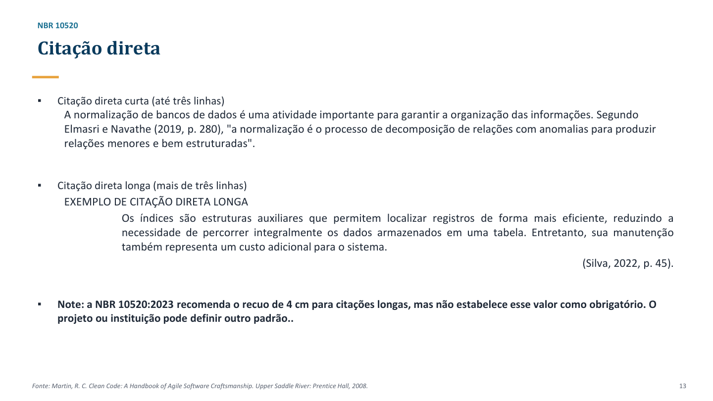
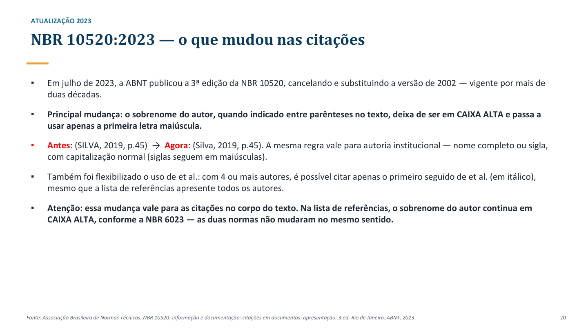
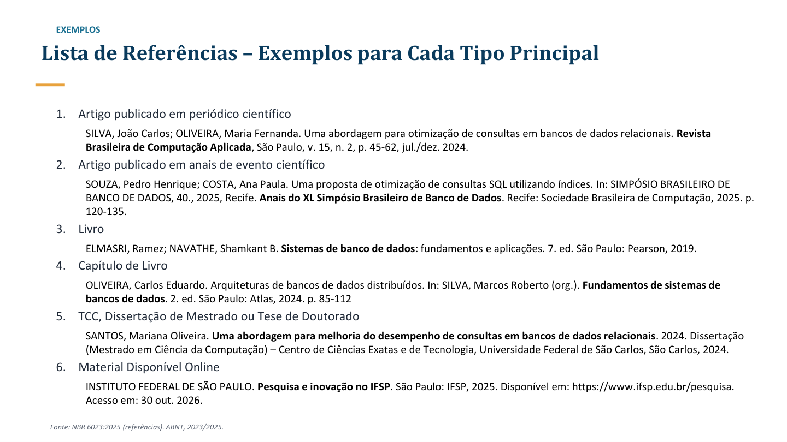
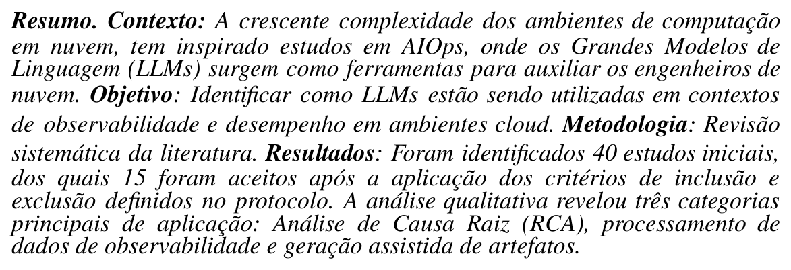
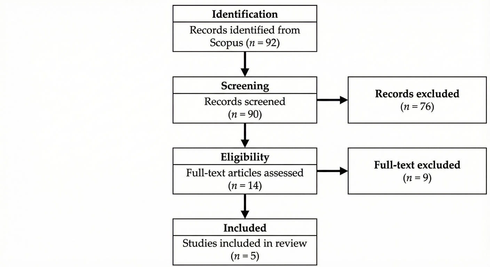
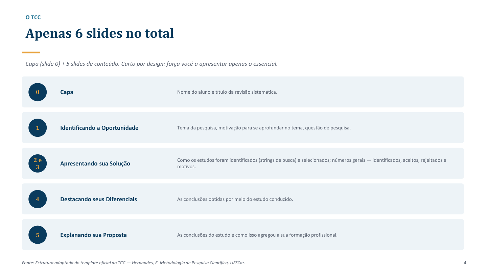

# 2026-10-30 - Metodologia de Pesquisa — transcrição revisada para leitura

- Fonte atual (vídeo; áudio de envio removido): [2026-10-30 - Metodologia de Pesquisa.mp4](../gravacoes/2026-10-30%20-%20Metodologia%20de%20Pesquisa.mp4)
- Vídeo de origem: [MP4 local](../gravacoes/2026-10-30%20-%20Metodologia%20de%20Pesquisa.mp4)
- Derivada de: [original Soniox](raw/2026-10-30%20-%20Metodologia%20de%20Pesquisa.soniox-original.pt.md)
- Provedor: Soniox `stt-async-v6`; dicas de idioma: português e inglês.
- Revisada em: 2026-11-06.
- Revisão: melhor esforço por IA, a partir do texto completo e de quadros selecionados do vídeo. Não houve audição integral nem validação humana.
- Falantes: rótulos automáticos preservados; números não identificam pessoas de modo confiável.
- Complemento: materiais originais conferidos no vídeo; [seleção visual e justificativas](../capturas/README.md).

## Revisão e limitações

- Grafias técnicas foram normalizadas: “Wet All” → et al.; “encaixável” → em caixa alta; “A SSN/E SSN” → ISSN; “Márcio Navatti” → Elmasri e Navathe; “Martim” → Martin; “Mel e Gracie” → Mell e Grance. Os exemplos visuais sustentam essas leituras, sem confirmar a formulação acústica exata.
- “referências para gráficos” → referências bibliográficas; “e-mail eletrônico” → meio eletrônico; “trinque de busca” → string de busca; “Legibilidade” no fluxograma → Elegibilidade. Zorzo e Elis foram normalizados pelo contexto da disciplina.
- Há indícios de troca/mistura de falantes em 01:10:32, 01:11:40, 01:18:54 e 01:23:16; esses blocos estão sinalizados. Não foram atribuídos nomes nem corrigida a diarização por suposição.
- Os exemplos exibidos são material didático. As referências neles escritas não foram verificadas como publicações reais e os resultados de TCCs de exemplo não são resultados do trabalho do aluno.
- Em 00:17:28–00:18:12 e 00:40:57–00:41:22 há discussão/correção da posição do ponto nas citações. A incerteza e as falas foram mantidas; o exemplo projetado não constitui uma validação normativa.
- O slide de apresentação usa linguagem prescritiva sobre seis slides, mas em 00:58:02–01:00:52 o docente diz que seis é uma sugestão e enfatiza o tempo disponível. Na lista do Moodle fornecida pelo aluno, o template aparece como opcional; essa indicação não foi reconferida no Moodle nesta tarefa. Confirmar as exigências atuais antes da defesa.
- Em 01:01:51 a entrega de novembro é chamada oralmente de “versão final”; em 01:16:53–01:17:28 a turma distingue a versão para a banca da posterior versão final. Consulte o inventário do Moodle e as tarefas atuais para os prazos; a transcrição preserva a fala original.
- A pergunta sobre autores de mesmo sobrenome e ano (00:37:02–00:38:28) não é respondida de forma conclusiva. A plataforma da defesa e a abertura ao público (01:12:35–01:13:26) também são apresentadas com incerteza.

## Transcrição

**[00:00:00] Speaker 1:** Gravação oficialmente. Boa noite para todo mundo. Então, a ideia aqui hoje, nesse início de aula, é dar uma passada com vocês. É... tem algumas atualizações das normas ABNT. Não sei quão familiarizados vocês são com a questão de referências, citação, etc. É... mas aí teve uma leve atualização em 2025, tá? Então, para a gente estar mais antenado e fazer da forma mais atual ali a questão de referências para gráfico, de como a gente cita no texto, principalmente ali. Bom, e depois passar umas dicas aí sobre a apresentação, sobre o que a banca espera, o que tem que ter nos meus slides, coisas desse tipo aí para orientar vocês nesse sentido. Bom, é... então a gente vai es- a nossa escrita aí. Então, lembrando que a gente tem um TCC para escrever, que é um artigo de 10 páginas no máximo, e isso já incluindo as referências, tá? Então, lembrem-se que o template desse arquivo, ele pode ser no formato DOC, é... a gente segue lá mais ou menos a linha da SBC. Ou, é... quem gosta de trabalhar com LaTeX também, tá?

**[00:01:30] Speaker 1:** Tem lá os links no primeiro material do primeiro tópico 1, lá, o primeiro material do primeiro dia de aula. Tem essa questão aí, tem lá os links, tem tudo lá, tá? Então, a gente tem 10 páginas. Então, e ali no Moodle também tem um template, né, do arti- do artigo, explicando sessão por sessão o que você tem que colocar. Aí você pode abrir, se você for fazer no Word, você pode abrir ele e vai completando as sessões, apagando lá as coisas de referência, etc. Então, dá para seguir, dá para se orientar por meio dele ali, tá? É... então, a ideia aqui é a gente falar um pouquinho sobre uma coisa que pega bastante, que é como que a gente faz referência, citação, e o que mudou um pouquinho recentemente aí com essa norma NBR 6023 de 2025 e 10520 de 2023, que são as vigentes atualmente, tá? No que diz respeito a referências, citações. Então, a norma NBR 6023, ela fala sobre elementos e formatos por tipo de fonte. Como que eu referencio lá no final, lá nas referências bibliográficas, um livro, um trabalho acadêmico, uma tese, um artigo, sites, que porventura eu possa ter consultado.

**[00:02:46] Speaker 1:** Então, lá tem, ela vai indicar ali mais ou menos se mudou alguma coisa do que vinha sendo feito. A gente vai ver exemplos ali que vocês podem seguir, tá? A outra norma, 10520, ela fala sobre como se eu vou citar autores que eu estou lendo no meu texto, aí é durante o texto, né? Se eu vou fazer uma citação indireta, que é o que a gente mais usa, como que eu faço? Se eu vou fazer uma citação direta, como que eu devo colocar no meu texto? Se eu vou fazer citação de citação, como que eu coloco também, tá? Deixa eu permitir aqui. É... vamos lá. Sobre a lista de referências, que a gente vai colocar no final do nosso artigo lá, tá? Então, o que isso estabelece lá na norma? Os elementos essenciais, aquilo que eu tenho que ter, e complementar também, aquilo que eu posso adicionar lá, que é opcional, tá? Sobre as referências bibliográficas. É... tinha uma edição de 2018, de 2018 que era vigente, e essa de 2025 veio então substituí-la. Então, o que a gente tem mais atual sobre como referenciar as coisas está nessa norma aí, tá?

**[00:03:57] Speaker 1:** A estrutura não mudou, tá? Continua lá sendo autor, depois o título, edição, aí tudo depende de que tipo de citação que é, mas a estrutura não mudou, tá? O que mudou é o formato que a gente usa lá no meio do texto, por exemplo. É... então, essa norma, ela regula apenas a lista de referências. A citação já é a outra ali que a gente, que eu também vou comentar com vocês, a 10520. Então, não confundir as duas. Então, referência para livro. Então, até três autores, ó, a gente coloca o sobrenome da pessoa em maiúsculo. Aqui, é... pode ser a abreviação dos nomes e pode ser o nome completo também, tá? Se chamasse aqui Sérgio Mota, poderia ser Sérgio Mota, e aí o sobrenome Arruda na frente, né? É... então, aqui poderia ser das duas formas. Então, tem lugares que usam com abreviado. Acho que no caso de vocês, até faz mais sentido, vocês têm pouco espaço, né? É... usar a abreviação ali dos nomes, tá? O sobrenome completo e a abreviação dos nomes. Quatro ou mais autores, a gente pega o primeiro, Lima EL, que são as iniciais dele, ou o nome completo, et al., tá?

**[00:05:08] Speaker 1:** Essa expressãozinha em latim aqui, que significa outros, né? É... então, de quatro autores para cima, seja um livro, seja qualquer coisa, a gente usa essa, é... esse et al. É... aí a gente deixa em negrito o título do livro, tá? É a única coisa que fica destacada ali na nossa referência, é o título do livro que a gente está citando. Se for meio eletrônico, por exemplo, a gente tem sempre que, depois de fazer citação, colocar lá "disponível em", "acesso em". O último acesso que você fez foi em tal data. Aí isso a gente tem que ter em qualquer coisa que a gente for de meio eletrônico ali a indicação. É... com relação a trabalhos acadêmicos, se eu estou usando algum TCC, alguma dissertação de mestrado, alguma tese de doutorado, tá? O jeito de citar aqui. É... primeiro aqui está errado, o sobrenome é maiúsculo, tá? Vou corrigir depois. É... como estão os dois últimos aqui, ó? Ribeiro E. da S., ou pode ser os nomes completos aqui, por exemplo, se fosse Eduardo da Silva, eu poderia colocar ali também o nome completo, tá?

**[00:06:19] Speaker 1:** O título em destaque. Título da dissertação, título da tese e tal. E aí tem os componentes básicos: o ano, se é uma tese, se é uma dissertação. Então, isso daí são as coisas básicas. Isso aqui são exemplos que você pode seguir, tá? Se eu for citar uma, por exemplo, alguma coisa de uma tese, pode pegar por esse exemplo aqui que vai dar certo. É... referências a artigos de periódicos, que são os nossos, é... articles, né? Os artigos de revistas de periódicos, e os artigos de eventos científicos, que são os nossos conference papers, tá? É... artigo, é... de revista de periódico, a gente usa aqui sempre essa estrutura, né? Autor, título e tal. Quando é um artigo de periódico, a gente coloca em destaque o nome do periódico. No caso aqui, HSM Management. Aí vem vírgula, onde que ele foi publicado, a cidade, o ano, o volume, número de páginas, número de páginas. Aí, em que página dessa revista que está no nosso artigo, se é do 100, que a gente está usando, se é do 100, no caso aqui da 102 à 106, e o ano de publicação, mês e ano, né?

**[00:07:27] Speaker 1:** Setembro, outubro de 2008. Então, quando for um article, um artigo de revista, é... que não é conferência, né? Conferência é aquelas que a gente pega a citação e está lá, é... que aconteceu, é... por exemplo, 16a conferência em engenharia de software. Ou 17a... então, tem todas aquelas, é... indicando o evento, onde ele foi, o ano que ele foi. Normalmente tem um número, 3o Congresso Nacional de Medicina. Então, está lá escrito. Isso aí são eventos científicos, são conference papers. O resto são aqueles que são publicados em periódicos, em revistas, esses, é... a gente trata como artigos lá de periódicos, tá? É... então, nos artigos de periódicos, vem aqui o nome dos autores, o nome do artigo, mas não é o nome do artigo destacado, ó. É o nome da revista, ó. Por exemplo, no documento arquivístico digital enquanto fonte de pesquisa. Esse era o nome do artigo publicado. Mas quando é periódico, a gente destaca o periódico, Perspectivas em Ciência da Computação, tá? Volume 21, é... edição 4, esse artigo foi publicado nas páginas, eu encontro ele nas páginas 121 a 137, em 2016, tá?

**[00:08:46] Speaker 1:** Mas se é, no caso aqui, se ele está disponível online, ó, disponível em, coloca o site, acesso em, a data que você fez acesso. É... e aqui, é... eventos, né, que são publicados em anais de congresso, anais de evento. Aí tem também até mesmo estrutura. Os autores, é... até três, eu posso citar os três nominalmente. Se tiver mais, eu posso colocar ali o primeiro, et al., também sem problema nenhum. É... então, aqui, incorporação em simpósio, ó. Aqui eu devia destacar, corrigir aqui também. Anais, está vendo que tem anais aqui com esses três pontinhos em colchetes? Porque repetiria aqui, ó. Anais em simpósio brasileiro de banco de dados. Posso repetir aqui, anais em simpósio brasileiro de banco de dados, ou eu posso usar essa estruturazinha aqui do colchete, com os pontinhos, que se refere ao mesmo título aqui do INA, tá? Que é o simpósio que aconteceu ali. Mas a gente destaca aqui o anais, tá, tá, tá, tá, tá, tá, tá. Tem um exemplo mais melhor lá no final, tá? É... referências a coisas online, tá?

**[00:09:59] Speaker 1:** Então, a gente sempre coloca aqui em maiúsculo a nossa biblioteca comunitária UFSCar. Sempre disponível em, acesso em no final, tá? Coordenação de aperfeiçoamento de pessoal de nível superior. Isso aqui é a minha referência em maiúsculo. Portal de periódicos, aí disponível em, acesso em. O que mudou? Por exemplo, se eu vou citar o DOI do paper lá, às vezes eu sei o DOI do paper, eu quero colocar: o paper foi publicado em, em tal evento, anais de tal evento, em tal ano, aí eu coloco no final o DOI. O que mudou? Antes a gente colocava assim, ó, DOI e o número. Agora a gente passa a colocar desde o HTTPS, ó, HTTPS, dois pontos, barra barra, DOI.org, e aí o número, DOI do documento lá, ó. Número para encontrá-lo, tá? Então, agora é o link completo e não mais só DOI e o número dele. A gente coloca o link completo. Essa foi uma mudança que teve aí na norma, tá? ISSN deixa de ser elemento essencial, novos modelos de fonte e regras mais claras para aquela parte do acesso em. Acho que com os exemplos no final a gente pode ficar mais melhor ali para a gente olhar e até para a gente usar no nosso TCC ali.

**[00:11:18] Speaker 1:** Ferramentas de apoio que podem me ajudar, se eu quiser colocar as referências lá e falar para ela corrigir conforme a ABNT, ó. Então, tem aqui algumas ferramentas que podem ajudar nisso, tá? Que é a MORE, que é da UFSC, a Facilis, ou Facilis deve ser, da UESB. Tem o Zotero, o Mendeley, que são geradores de referência, tá? Eles tentam aplicar o estilo ABNT automaticamente ali via plugins que eles têm lá de estilos. É... é... IAs em geral, tá? Se a gente colocar e pedir para ela formatar de acordo com as referências, as normas mais atualizadas da ABNT, pedir para ela dizer quais são, para conferir se ela cita essas duas aí, por exemplo, tá? É... só que, ó, nenhuma ferramenta substitui a conferência manual. Então, não é porque eu joguei lá, ele me devolveu lá as minhas 10 referências, que eu não vou bater o olho e ver se está no formato correto. Elas me ajudam, mas às vezes pode passar alguma coisinha, então não deixem, mesmo que você use uma ferramenta de apoio, de hora que tiver com a versão final aí das referências, não deixe de olhar é...

**[00:12:25] Speaker 1:** se está tudo citado lá direitinho, tá? Questão de múltiplos autores, autoria, etc. A outra norma lá, que fala de citações, ó. Quando a gente está escrevendo o nosso texto, a gente tem três tipos de citação. A que a gente vai usar 90, 95% das vezes é a citação indireta, tá? Quando a gente fala 2 João, 2025, tá, tá, tá, tá, tá, tá, tá, tá, tá, tá, essa é a citação indireta, tá? Mas existe aquela citação direta, que é a que a gente quer colocar, traduzir aí. A indireta a gente escreve com as nossas palavras aquilo que a gente coletou da ideia que o autor descreveu, tá? E quando a gente vai copiar, copiar o que a pessoa escreveu, aí a gente chama de citação direta. Eu vou realmente transcrever. Eu pego, copio e colo, é... dizendo que é uma citação direta ali. Estão me esperando. E aí também existe a citação da citação, tá? Que é quando, ah, o João escreveu alguma coisa, o Marcelo publicou aquilo que o João escreveu. Eu não tive acesso ao original do João, só ao que o Marcelo escreveu, mas o Marcelo cita o João.

**[00:13:37] Speaker 1:** Então, eu posso, no meu trabalho, dizer que eu estou citando o João, é... a gente usa esse apud de Marcelo, é por meio do Marcelo, né? Então, quem escalou isso foi o João, mas eu li isso no trabalho do Marcelo. Então, existe essa citação de citação também, que a gente usa o apud. Então, exemplos aqui de citação direta, ó. Como é que eu coloco isso no meu texto? Se tiver até três linhas, se ela não for muito grande, então eu coloco ela é... entre aspas. Então, aqui tem um exemplo, ó. Segundo é Elmasri e Navathe, 2000, é um livro, né? 2019, página 280. É... isso é uma das coisas que mudou, tá? A gente não usa mais nada em maiúsculo no texto quando a gente está falando de autores. Agora é sempre é... com essa primeira maiúscula, os nomes estão em primeira maiúscula, o resto em minúscula. Não importa em que parte que eu use, sempre essa estrutura aí. Nunca vai ter o nome do autor todo em maiúsculo, o sobrenome deles lá, tá? Antigamente a gente usava. Então, essa é uma mudança que teve aí. Então, segundo é Elmasri e Navathe, aí eu transcrevo, abro aspas e transcrevo o que o cara escreveu lá no livro.

*Conteúdo de [Parte5-TrechosABNT2026.pdf, página 13](../materiais/Parte5-TrechosABNT2026.pdf#page=13), conferido no vídeo em 00:14:30. Slide didático de citação direta. As afirmações normativas e as referências do exemplo não foram verificadas independentemente.*

**[00:14:50] Speaker 1:** Isso é uma citação direta, tá? É... é a menos comum, tá? Mas é... a gente usa. Se for longa, mais de três linhas, é... aí a gente usa, ó, a gente desloca, a gente coloca num parágrafo e desloca, ó. A sugestão da norma é de quatro centímetros da margem. A gente desloca quatro centímetros para dentro e, no final aqui, coloca o autor na linha de baixo. É Silva, 2022, página 45. Então, essas são para citações diretas longas, esse deslocamento aqui num parágrafo. Mais de três linhas, até três linhas a gente pode usar ali com as aspas, tá? Beleza, ó. Ele fala até que é a recomendação de quatro centímetros, mas isso não é obrigatório. Quem... a instituição pode redefinir isso, ou o projeto, ou o SBC, qualquer coisa aí pode redefinir esse tamanho aí. Tudo bem? Estamos tendo citação direta. A indireta, a gente tem algumas formas de escrever a mesma ideia. A gente pode, por exemplo, aqui, ó. Martin, 2008, recomenda que funções tenham poucas linhas, favorecendo a legibilidade. Beleza, é uma forma de escrever.

**[00:16:03] Speaker 1:** Eu posso também escrever assim, ó. De acordo com Martin, 2008, funções devem ter poucas linhas para favorecer a legibilidade. Ou eu posso: a recomendação de que funções tenham poucas linhas, blá-blá-blá-blá-blá-blá-blá-blá-blá. E no final coloco entre parênteses Martin, 2008. As três formas são possíveis, tá? Antes, essa última, essa terceira, a gente colocava tudo em maiúsculo, não mais, tá? Então, vai ser encontrado sempre assim, com a primeira letra do sobrenome das pessoas em maiúsculo. E, obviamente, isso a banca vai fazer, quem estiver lendo o seu artigo vai lá na lista de referências ver se existe essa referência. O que é Martin, 2008? Aí a gente vai lá na lista de referências, conferir se está lá. Beleza? Então, não pode ter uma citação ali no texto. É... é... Oliveira, 2022. E diz que, tá, tá, tá, tá, tá, tá. E aí não falta essa referência lá, Oliveira, 2022. Não pode, tá? Isso é um erro que certamente a banca vai fazer se o cara crachar aí é... do que você está citando no seu texto, se está lá na lista de referências, tá?

**[00:17:10] Speaker 1:** Então, lembrando que a gente não copia e cola dessa forma direta o que o cara escreveu lá. A gente pega a ideia e transcreve com as nossas palavras, tá? Essa é a citação mais que a gente mais usa aí, que é a citação indireta, tá? Pois não, Maicon, pode falar.

**[00:17:28] Speaker 2:** Professor, o ponto... a... ali Martin, 2008, na última, ele vai depois do ponto final? Tipo, se tiver no meio de uma frase, né? Porque daí vai ter mais uma sentença, sei lá, vai ter num parágrafo, no caso, né? Se tiver mais de uma frase, daí teria que ser antes ou depois de um ponto final?

**[00:17:51] Speaker 1:** É... peraí, ó. No meio aqui, você está falando tipo aqui de acordo... Ah, entendi o que você falou. Entendi, entendi, entendi. Não, é... entendi. Faz sentido ser antes do ponto final, sim. Sim.

**[00:18:02] Speaker 2:** É porque a última frase está depois do ponto final.

**[00:18:05] Speaker 1:** Sim, sim. Cara, isso aí é um detalhe, mas acho que faz mais sentido ser antes do ponto final mesmo.

**[00:18:11] Speaker 2:** Beleza. Obrigado.

**[00:18:12] Speaker 1:** É, o seu exemplo é muito bom. Se eu vou continuar com uma outra frase, não faz sentido a frase começar com Martin, 2008, sim. O ponto vem depois. Eu vou corrigir essas coisinhas aí. Mas bela observação. Tudo bem aqui, pessoal? Citação direta, citação indireta, tranquilo? Ó, é... aí tem exemplos aqui, mas depois eu vou dar ali no final exemplos de tudo, acho que fica... É... a gente já viu aqui, né? Exemplos de citações diretas e tal. Aquele... lembra a citação de citação, ó. Então, aqui, ó. A citação de citação acontece quando o pesquisador deseja utilizar uma informação de determinado autor, mas não teve acesso à obra original. Ele encontrou aquela informação reproduzida ou mencionada em outra obra. Tem um exemplo aqui, né, que a gente... do uso do apud, que significa citado por... É... então, aqui, ó. Imagine que você esteja lendo um livro de Oliveira, 2022, e encontre nele uma ideia desenvolvida originalmente por Pereira, em 2015. Você não conseguiu consultar o trabalho de Pereira, de 2015, mas deseja utilizar a ideia dele.

**[00:19:27] Speaker 1:** Assim, no texto acadêmico, a gente usa, ó. Segundo Pereira, que foi o cara que falou isso em 2015, apud de Oliveira, ah, esse apud tem que estar em itálico, tá? Apud de Oliveira, ou seja, citado por Oliveira, em 2022. Bom, então isso é uma citação de citação, esse apud aí que a gente pode usar no nosso texto se a gente encontrar algum caso que a gente não teve acesso ao documento original ou a gente achou interessante uma ideia de alguém, mas a gente leu por meio de outro autor. Tudo bem, pessoal? Então, ó, citação direta, indireta e citação de citação são as três formas que a gente pode usar no nosso texto, tá? Normalmente, a gente vai trabalhar com a citação indireta ali, é o caso maior que vai acontecer no nosso texto. É... o sistema de chamada, tá? É... o que é o sistema de chamada lá? Se a gente vai indicar... é... as... as... as citações, ó. Silva, 2020, ou se aquele... quando a gente usa aquela por número, tá? A lista numerada. Então, lá nas referências, a gente coloca: número 1 é essa referência, número 2 é essa referência, número 3 é essa referência.

**[00:20:42] Speaker 1:** E no nosso texto, onde a gente está escrevendo, em vez de a gente colocar: segundo Silva, 2020, página 27, a gente coloca: segundo 2, entre colchetes, tá? Que é a referência 2. Então, isso... é... existem essas duas formas de sistema de chamada aí que a gente fala, né? Ou autor data, que é o que a gente mais usa, ou numérico. Aí depende do numérico. Às vezes você tem... é... publicações que são só de seis páginas, então, se você fica lá colocando, repetindo muito, então, tudo que você consegue economizar e melhor, às vezes eles aceitam esse sistema numérico. A gente escolheu para o TCC de vocês o autor data, tá? Então, a gente vai usar essa do Silva, 2020, Oliveira, Marques e Silva, 2022, a gente vai usar essa de autor data. Beleza? É a que a gente vai recomendar para vocês aí. Mas existem as duas formas aí. Lá no final, a... as referências vão aparecer por ordem alfabética, tá? Pelo sobrenome, a ordem alfabética do sobrenome. Não é por ordem que aparece no texto, tá? É por ordem alfabética de sobrenome.

**[00:21:51] Speaker 1:** Beleza? Porque é mais fácil de encontrar. A gente, lá... Silva, 2018, é, pô, a gente vai lá e já vai olhar por ordem alfabética o que é Silva, 2018. Ou Silva e Andrade, 2022. A gente vai lá no Else e já vê lá Silva, Andrade, 2022, bate o olho. Então, não é ordem de aparição do texto, é ordem alfabética por sobrenome de autor, lá nas referências bibliográficas. Então, atualizações. O que mudou aí em relação à norma, tá? É... principal mudança. O sobrenome do autor, quando indicado entre parênteses no texto, não é mais em caixa alta. Como eu falei para vocês, ele passa a usar a primeira letra em maiúscula apenas. Então, no texto de vocês, no texto lá antes das referências, é... não é para usar o sobrenome da pessoa em maiúsculo em caixa alta o tempo todo, tá? É só a primeira nas citações. Então, isso é uma... tem até o antes e depois aqui, ó, em vermelho ali. Então, presta atenção nisso na hora que vocês estiverem escrevendo. Tá? Então, também foi flexibilizado o uso de et al, tá? Com quatro ou mais autores, é possível citar apenas o primeiro e o et al em itálico.

*Conteúdo de [Parte5-TrechosABNT2026.pdf, página 20](../materiais/Parte5-TrechosABNT2026.pdf#page=20), conferido no vídeo em 00:22:30. Registra o que o slide da aula apresenta; conferir a norma e o template aplicáveis ao escrever.*

**[00:23:06] Speaker 1:** Mesmo que a lista de referências, mesmo que eu tenha lá o nome dos seis autores, eu posso usar só do primeiro et al, tá? Aí vai... eu posso colocar os seis? Posso, mas segundo a norma ali eu posso já colocar só o primeiro et al ali tranquilamente. Então, atenção, essa mudança vale para citações no corpo do texto. Na lista de referências, o sobrenome continua em caixa alta, tá? Lá embaixo, na seção de referências. É só a hora que eu estou citando lá no meu texto que eu não uso mais em maiúsculo. Então, a outra norma aqui... O que tem aqui? A mudança do DOI, que eu expliquei para vocês, não é mais na citação só DOI o número, agora a gente coloca o caminho todo, DOI, a URL toda lá, tá? Mas a estrutura básica lá que a gente coloca para compor uma referência, o nome dos autores, título da publicação, se tiver edição, local, continua a mesma coisa. A estrutura permanece a mesma lá nas referências. Aqui tem exemplos, tá? Antes e depois, ó, como é que era a citação. Antes em maiúsculo, tal, passa para essa versão atual.

**[00:24:20] Speaker 1:** Sobrenome, lá na lista de referências, lá na seção de referências, a última do texto, não muda. O Silva continua em maiúsculo, era e continua em maiúsculo. O DOI a gente registrava assim antes, agora a gente passa a registrar de uma forma mais completa lá na referência. Por exemplo, evento de conferência, paper lá. Se eu tenho o DOI dele, eu posso colocar lá depois das informações, no final eu coloco o DOI dele lá, para localizar facilmente. Tá? ISSN em periódico. Era um elemento essencial, antes eu era obrigado a informar, agora não é mais, tá? Se eu não tiver ou se eu não quiser, ele é um elemento opcional, se for uma revista, se for um periódico, o número do ISSN. E os locais dos eventos, o local do evento, se aconteceu em Milão, na Itália. É... em Porto Alegre, no Brasil, isso era sempre obrigatório colocar a cidade onde aconteceu o congresso, onde aconteceu o evento científico, agora não é mais, tá? Se eu não tenho essa informação, eu não sou obrigado a colocar. Se eu tiver, eu ponho.

**[00:25:26] Speaker 1:** Se não tiver, não é mais obrigatório ali. Continua igual a estrutura lá básica da referência. Isso a gente já falou, está aqui de novo. Isso aqui eu queria colocar, ó, exemplo. Então, esse slide aqui vocês podem usar, ó. Se o meu estudo primário é um artigo publicado num periódico, numa revista, então eu posso usar essa estrutura aqui, ó. Aqui eu estou com dois autores, ó, os sobrenomes aqui, pode ser só a inicial do nome ou pode ser o nome completo e os sobrenomes em maiúsculo. Aí tem lá o título do artigo e aqui em destaque, ó, o nome da revista, Revista Brasileira de Computação Aplicada, cidade, volume. Então, vocês podem utilizar isso aqui como base, tá? É... se for um artigo publicado em evento científico, é em revista, perdão. Em análise de eventos, ó. Então, tem aqui os autores com sobrenome em maiúsculo, uma... o título do artigo, uma proposta de otimização de consultas SQL usando índices. Em Simpósio Brasileiro de Banco de Dados, 40a edição, 2025, Recife. Aí vem aqui lá, análise do...

*Conteúdo de [Parte5-TrechosABNT2026.pdf, página 24](../materiais/Parte5-TrechosABNT2026.pdf#page=24), conferido no vídeo em 00:26:30. Exemplos didáticos de formatação, sem verificação de existência das publicações ilustrativas.*

**[00:26:37] Speaker 1:** É... 40, né? L é 50. Do 10... do 40o Simpósio Brasileiro de Bancos de Dados. Isso que é o destacado aqui, ó. Tá? Ou, se eu não quiser repetir, eu coloco anais e os três pontinhos entre colchetes lá. Livro. Então, tem os autores aqui, aí o nome do livro destacado. Aí... ó, aqui eu tenho título e subtítulo, ó. Sistema de banco de dados é o título, dois pontos, subtítulo. É só o título que é destacado no livro. Se tiver subtítulo, o subtítulo não fica em negrito, tá? É só o título principal mesmo que vai para negrito. Capítulo de livro, ó. Não estou citando o livro todo, estou citando o capítulo 5 do livro aqui, porque às vezes o livro tem vários autores e cada autor escreve um capítulo. Então, aqui eu estou citando, ó, o capítulo escrito pelo Oliveira, Carlos Eduardo Oliveira. O capítulo dele é sobre arquitetura de bancos de dados distribuídos. Em... onde que esse capítulo se encontra? No livro, publicado por Marcos Roberto Silva, Fundamentos do Sistema de Banco de Dados, 2a edição, tal, tal, tal.

**[00:27:41] Speaker 1:** Então, aqui o destaque é para o nome do livro, não do capítulo que eu estou fazendo a citação ali. TCC de dissertação de mestrado ou tese de doutorado. É essa estrutura, destaque para o título. É... e quando coisas disponíveis online, a gente coloca como a gente vai citar em maiúsculo. Por exemplo, ali, Instituto Federal de São Paulo. Isso aí é como eu citaria no meu texto. Lá no meu texto, eu colocaria alguma citação e lá no final eu poderia colocar entre parênteses. Instituto Federal ou IFSP, se fosse o caso, né? IFSP ou Instituto Federal de São Paulo, vírgula, 2026. Essa seria a minha citação lá no texto. Eu até colocaria IFSP aqui entre parênteses. É... IFSP, vírgula, 2026. Tá bom? Então, é... ó, estou olhando minhas referências, eu vou conferir, dá uma olhada nesse slide aqui, eu vou disponibilizar ele para vocês. E aí tem os principais tipos, acho que nada vai fugir muito disso aqui do que vocês estiverem fazendo. Principalmente vai ficar nesses dois primeiros, ó. Ou conference papers, que é o número dois, artigos de conferência, ou artigos de revista, de journals, de...

**[00:28:54] Speaker 1:** é... periódicos lá, que vai ser o primeiro. Vai ficar mais nesses dois primeiros aqui, eu acredito, de vocês, tá? Então, dá uma olhadinha para deixar nessa estrutura aí... é... do texto. Tudo bem aqui, pessoal? Sobre as normas, sobre como fazer a citação, sobre como fazer a referência? Beleza?

**[00:29:20] Speaker 2:** Tudo certinho, professor.

**[00:29:22] Speaker 1:** Pois não, Franco, pode falar. Franco? Não estou te ouvindo se você estiver falando.

**[00:29:40] Speaker 2:** Professor?

**[00:29:41] Speaker 1:** Oi, agora sim.

**[00:29:42] Speaker 2:** Oi, desculpa, eu estava mutado no microfone. A Isa mandou uma mensagem falando que ela está esperando para ser aceita na aula.

**[00:29:52] Speaker 1:** Cara, eu não estou... não estou com ninguém pendente aqui, não, cara.

**[00:29:59] Speaker 2:** Tudo bem.

**[00:30:00] Speaker 1:** Não tem ninguém pendente aqui para aceitar, não, tá?

**[00:30:03] Speaker 2:** Ok, obrigado. Eu vou mandar a mensagem para ela, então.

**[00:30:11] Speaker 1:** Será que ela está no link certo? Ela está... estranho. Ou entrou em link anterior, não, né? Bom, esse material eu vou disponibilizar aqui para vocês. É... vou abrir o outro aqui das dicas, ó. Eu vou compartilhar com vocês. Ah, antes de eu passar a dica... Antes de eu passar as dicas, eu vou fazer outra coisa. Tem uns exemplos de artigo, aí eles colocam uns exemplos lá no Moodle, mas eu vou usar outros aqui por padrão. Depois até se eu for usar os que você me autorizar, eu coloco esses dois que eu gostei bastante aqui. Não foi indicação do Zorzo de... de artigos que foram sobre... de TCCs, né? Que a gente recebeu lá com o pessoal. E viu que gostou bastante. Deixa eu ver aqui. Ó, esse aqui é um exemplo de um TCC escrito de um artigo, né? No formato de TCC de vocês. Deixa eu dar um zoomzinho aqui. Então, ó, o título, tal, então... Ele está... passou uma página, pessoal. Não é para passar, tá? Eu não sei se antes podia ser um pouco mais de página, até 11, ou se deixaram passar como 11, mas assim...

**[00:31:49] Speaker 1:** É 10. O limite é 10, vamos respeitar o limite. Tá? Ó, essa estrutura de resumo, isso aqui é muito usado em engenharia de software, tá? O resumo tem essas palavras-chave aqui: qual é o contexto, qual é o objetivo, qual é a metodologia, os resultados, tá? É... são, na verdade, o outro aqui está até melhor, que são os cinco que a gente usa. Contexto, objetivo, metodologia, resultados e conclusões. Eu já... eu faço um... a gente chama isso de resumo estruturado, tá? Então, a gente já estrutura o resumo nessas cinco palavras-chave. Qual é o contexto do meu trabalho, qual foi o objetivo, qual a metodologia que eu usei, os resultados que eu obtive e as conclusões que eu obtive. Então, esse é o resumo do meu trabalho. Isso aqui é... isso aqui é bem legal, tá? É... eu, quando eu comecei lá na área de engenharia de software, me ensinaram a escrever resumo assim. E todos os artigos que a gente submetia, o resumo a gente sempre escrevia nessa estruturinha aqui de... é... resultado, contexto, objetivo, metodologia, resultados e conclusão.

*Conteúdo de [TCC_DaviAugustodaSilvaRibeiro.pdf, página 1](../materiais/exemplos/TCC_DaviAugustodaSilvaRibeiro.pdf#page=1), conferido no vídeo em 00:32:00. O resumo mostrado contém Contexto, Objetivo, Metodologia e Resultados. Na fala, o docente recomenda também Conclusões e esclarece que essa estrutura é uma sugestão.*

**[00:32:52] Speaker 1:** É uma dica aí, não é? Eu sou obrigado a escrever resumo assim? Não sou, tá? Mas é uma dica. Pois não, pode perguntar ali, vi.

**[00:33:01] Speaker 2:** Esse... esse gabaritinho é show de bola, cara. Ele deixa certinho o começo, meio e fim ali. Mas aí... é... claro, o senhor falou que era uma sugestão, mas assim, é costumeiro colocar ali item, dois pontos, ou também é... é aceitável colocar só o...

**[00:33:16] Speaker 1:** Então, pode ser implícito também, né? Pode colocar ali explicitamente, mas...

**[00:33:21] Speaker 2:** Mas na linha guia, assim, de tipo...

**[00:33:22] Speaker 1:** É...

**[00:33:23] Speaker 2:** Essas coisas para poder separar.

**[00:33:24] Speaker 1:** Exato. Eu posso fazer isso como um texto corrido, implicitamente está falando do contexto, do objetivo, não preciso estruturar exatamente com esses dois pontos as palavras, tá?

**[00:33:34] Speaker 2:** Então, show. Show, show, show. Boa. Isso é bom.

**[00:33:38] Speaker 1:** É... Beatriz?

**[00:33:40] Speaker 3:** A minha dúvida é em relação ao parágrafo. Não é para dar espaço do parágrafo?

**[00:33:45] Speaker 1:** Ah, então. É... precisa ver o template que está lá no Word, que está disponibilizado. A gente pode olhar. Às vezes, aqui, toda sessão, às vezes tem uma... acho meio frescura isso aqui, ó. Ela começa o primeiro parágrafo encostado e os outros têm. Está vendo a seção 1 aqui, introdução?

**[00:34:01] Speaker 2:** É, a gente tem isso aí também, né, professor?

**[00:34:03] Speaker 1:** É.

**[00:34:03] Speaker 2:** Isso é uma regra, né?

**[00:34:05] Speaker 1:** É... eu não sei se é uma regra, isso é de... de template para template. Precisa ver o template lá que está no... depois a gente pode até abrir o templatezinho lá que está aqui.

**[00:34:13] Speaker 3:** Não, não tinha reparado. Achei que era alguma coisa assim que estava editando, porque achei que era.

**[00:34:17] Speaker 1:** Pode até olhar aqui o templatezinho.

**[00:34:18] Speaker 3:** Boa.

**[00:34:21] Speaker 1:** Então, deixa eu ver se o outro exemplo que tem aqui, como é que está...

**[00:34:24] Speaker 2:** Professor.

**[00:34:25] Speaker 1:** Ah, o outro está todo encostado aqui, está vendo? Eu acho que o que está no Moodle está todo encostado. Deixa eu ver aqui. É... pelo que eu estou olhando do templatezinho que está lá, está tudo encostado à esquerda, ó. Não está tendo o parágrafo lá.

**[00:34:38] Speaker 3:** Então, a gente segue como está lá, né?

**[00:34:40] Speaker 1:** É... segue como está lá, isso. É... aqui, eu não estou nem mais... é... foi uma ótima observação, tá? Acho que você pode seguir tudo encostado aqui, do jeito que está lá. Bom, igual o outro fez aqui, o Marcos fez, ó. Aqui é mais a estruturação mesmo, eu nem tinha reparado nisso, mas eu queria mais trazer a estruturação que a gente espera ali. É... é... ler, tá?

**[00:35:02] Speaker 2:** Daí, nesse exemplo, as referências ainda estão do modo antigo, né? Maiúsculo.

**[00:35:06] Speaker 1:** Sim, são... são... eu não sei nem de que ano que foi isso aqui, tá?

**[00:35:09] Speaker 2:** Bom.

**[00:35:10] Speaker 1:** Não sei nem o que dizer. Foi só um que eu... textualmente agradeço. É isso, ó. A gente não quer isso, não espera encontrar isso aqui. É só para estar com M em maiúsculo e com G em maiúsculo aqui. E também não tem mais esse ponto e vírgula. É Mell e Grance, Mell e Grance, 2011. É... et al. deveria estar em itálico, ó. Então, tem problemas, tá? Tem problemas. Então... mas é só para a gente ver o que colocar nas sessões, assim. Então, nesse exemplo aqui, ó, eu tenho uma introdução. É... pois não. Ou Beatriz ainda tem dúvida ou...

**[00:35:47] Speaker 3:** Ah, eu ia perguntar em relação ao et al. aí, se a gente sempre bota esse ponto e vírgula nele.

**[00:35:55] Speaker 1:** É... o... o ponto é abreviação, sim, pode colocar. E a vírgula é para separar do ano, né? Porque é autor, vírgula, ano. Então, aí, sim, pode usar isso aqui, sim. et al.

**[00:36:07] Speaker 3:** Aí, se for na citação daquela outra forma, que é et al. segundo fulano de tal, et al.

**[00:36:13] Speaker 1:** Segundo Dengue et al., aí não. Aí você põe o 2023 entre parênteses. Ah, o pontinho você pode pôr. et al., pontinho você pode pôr. Tá, mas aí o... a vírgula não. Aí o vínculo... o ano está entre parênteses.

**[00:36:28] Speaker 3:** Vale, professor.

**[00:36:32] Speaker 1:** Michael.

**[00:36:33] Speaker 4:** Como tem dois autores ali, eu... é... por exemplo, posso usar o et al. se tem dois caras?

**[00:36:40] Speaker 1:** Caras, até três. Eu acho que é legal citar os três. É... como fala na norma lá. Tá bom? Então, está lá. Silva, Mendes e... e Oliveira. Vírgula, 2025. Até três, acho que você pode citar os três. A partir do... do quatro, você coloca lá Silva e et al.

**[00:37:02] Speaker 4:** Beleza. Uma outra dúvida, professor. Se tiver dois Silvas no mesmo ano, por exemplo, que é bem comum.

**[00:37:07] Speaker 1:** Silva e Silva. Ah, tá, entendi.

**[00:37:09] Speaker 4:** Não, quando tiver, tipo, duas referências Silva do mesmo ano, por exemplo, 2026.

**[00:37:14] Speaker 1:** Sim.

**[00:37:14] Speaker 4:** Né? Duas referências. E aí, como... eu acho que isso vai ser raro, né? Mas pode acontecer.

**[00:37:20] Speaker 1:** Acho que sim. Vai ser bem raro.

**[00:37:21] Speaker 2:** Nesse caso daí, pode usar o do... da chamada, professor? É porque eu estou... eu estou namorando essa ideia da chamada, porque ela vai ocupar menos espaço.

**[00:37:28] Speaker 1:** Chamada?

**[00:37:29] Speaker 2:** É, que tem o índice e daí lá embaixo.

**[00:37:32] Speaker 1:** Ah, o índice não, não, cara. A gente espera ler o nominal aqui. Autor, vírgula, ano. Tá? A gente optou por esse aqui no TCC de vocês. Não usa os números, não.

**[00:37:41] Speaker 2:** Parece tão mais econômico, né?

**[00:37:43] Speaker 1:** É, mais econômico, mas não usa, não.

**[00:37:45] Speaker 2:** Mas tranquilo.

**[00:37:45] Speaker 1:** Cara, boa pergunta do Silva aí, cara. Eu não sei o que responder agora, eu teria que dar uma pesquisada. Tá bom? É... a gente tem que dar um jeito de diferenciar, isso é fato. É... a gente vai ter que trocar o nome na... alguma coisa vai ter que estar diferente na... na... na... se eles são do mesmo sobrenome, do mesmo ano?

**[00:38:02] Speaker 4:** Sim, se acontecer, né? Não...

**[00:38:04] Speaker 1:** Puta, cara. Eu nunca vi.

**[00:38:05] Speaker 2:** Está acontecendo isso.

**[00:38:06] Speaker 1:** Vou ser sincero, eu nunca vi.

**[00:38:07] Speaker 2:** Você é escrito de que árvore, não sabe?

**[00:38:09] Speaker 1:** É, sim.

**[00:38:09] Speaker 2:** Se vai no SBC, mais impossível.

**[00:38:12] Speaker 1:** Está brincando. Eu não sei o que responder, cara, de verdade, porque eu nunca vi. Eu teria que pesquisar ali para te responder.

**[00:38:19] Speaker 4:** Tranquilo, professor. Obrigado, viu?

**[00:38:20] Speaker 1:** É raro. Mas eu te garanto que não vai acontecer no seu trabalho.

**[00:38:24] Speaker 4:** É, eu acho que não.

**[00:38:26] Speaker 1:** É.

**[00:38:26] Speaker 2:** Garanto é um termo forte.

**[00:38:28] Speaker 1:** É verdade. Eu estou ainda mais falando para um tester. Verdade. Eu presumo que não vai acontecer. É... Beleza, gente? Ó, vou seguir aqui, tá? Então, aqui tem uma introdução. É... Aí depois é a fundamentação teórica, tá? Então, a gente vai dar o contextualizar a nossa pesquisa, os autores principais, o que eles falam, caracterizar, o que que... se eu estou falando de LLM, quem caracteriza LLM, o que é, quem caracterizou, coloca um autor-chave ali caracterizando. Se eu vou falar de banco de dados, por exemplo, eu vou citar quem criou. Eu estou falando de SQL, então vou falar de onde surgiu o SQL, tal, coloco uma citação de SQL. Então, isso aí é o que vai dar... o cara não sabe nada do assunto. A fundamentação teórica é o que vai orientar a pessoa em relação àquele assunto. Eu estou falando de sistemas distribuídos, então tem que contextualizar para quem está lendo o que são sistemas distribuídos, que é uma citaçãozinha ali, tá? Então, vamos... essa fundamentação teórica é importante, tá?

**[00:39:38] Speaker 1:** Grandes modelos de linguagem, LLMs, são redes neurais de alta capacidade. Então, aqui está caracterizando o que são LLMs para quem está lendo conseguir entender o seu texto, tá? Que nem... Que que é DevOps, etc., tá? Daí depende do seu contexto de pesquisa aí. Isso aqui é muito importante, você vai ter que colocar até na sua apresentação, a metodologia usada, tá? Quais são as minhas questões de pesquisa, como é que eu montei esse string de busca, critérios de inclusão e exclusão, tá? Você vai descrever que você fez uma revisão sistemática, preencheu um protocolo, é... elaborou a... a... as questões de pesquisa, coloca elas, quais são, que elas serão respondidas, etc., que foram feitos... é... critérios de inclusão e exclusão dos estudos. Todo o rigor da metodologia lá foi seguido da revisão sistemática. Isso é importante aqui. Aquela questão de... do gráfico lá do PRISMA, do funil, tal, a partir de tantos estudos, aí eu... na primeira seleção, ali na fase de identificação, eu rejeitei tantos, sobraram tantos, para a fase de extração.

**[00:40:45] Speaker 1:** Então, tem os gráficos. Isso aqui é legal de colocar, tá? Isso aqui é uma coisa legal que ajuda aí a pessoa a entender quantos... Pois não, pode falar, Beatriz.

**[00:40:57] Speaker 3:** Ah, era só o ponto que alguém tinha comentado antes sobre a... a citação e o ponto. Aí nesse artigo ele coloca o ponto antes mesmo, né? Aí será que...

**[00:41:08] Speaker 1:** Olha, eu tenho um detalhe que não vai... eu... eu colocaria o ponto depois. E depois eu vou... vou... enquanto eu estiver aqui oficialmente, eu vou ver se o ponto é antes ou depois, tá? Mas eu... eu a princípio me faz mais sentido o ponto não ser depois.

**[00:41:22] Speaker 3:** É.

**[00:41:22] Speaker 1:** É. Mas ninguém vai te tirar nota por causa do ponto aí, pode ficar tranquilo. É... Jonathan?

**[00:41:32] Speaker 2:** Eu tenho uma dúvida sobre a questão das citações, né? A gente está fazendo revisão sistemática e no final a gente vai ficar com um conjunto de... de referências, né? Que a gente vai, obviamente, ter que apresentar aí no nosso TCC.

**[00:41:44] Speaker 1:** Sim.

**[00:41:45] Speaker 2:** Mas a minha dúvida é: as referências que eu vou ter nesse meu... nesse meu texto, no meu manuscrito, vão ser estritamente as mesmas que saírem do... da revisão sistemática ou, por exemplo, se eu precisar contextualizar e utilizar um outro artigo, está liberado utilizar algo que esteja por fora da revisão sistemática ou...

**[00:42:03] Speaker 1:** Ó, vamos lá. Então, vamos lá. Quando você estiver falando da sua revisão, quando você estiver discutindo sobre ela, é... concluindo, aí é sobre o que você pesquisou. Na parte lá inicial de introdução, contextualização, aí eu posso citar outros autores, tá? Aí, tranquilo, quem vai me dar fundamentação teórica das coisas aqui, não precisa ser. Coisas que eu... que vieram na minha revisão, na parte de contextualização, seja na introdução ou seja na fundamentação teórica. Agora, a partir daqui, quando eu estiver falando da minha revisão, aí eu só vou considerar os artigos da minha revisão. Beleza?

**[00:42:47] Speaker 2:** Sim.

**[00:42:48] Speaker 1:** Quando eu estiver falando de resultados de discussões, tal. Porque eu estou falando daquilo que eu selecionei. Então, eu estou usando aquilo, aquilo que eu extraí informação, aquilo que eu estou comparando, são os artigos da minha revisão.

**[00:43:02] Speaker 2:** Perfeito. Obrigado.

**[00:43:03] Speaker 1:** Beleza?

**[00:43:04] Speaker 2:** Nada.

**[00:43:07] Speaker 1:** Ó, então, a gente tem aqui toda a parte de metodologia, que é legal vocês colocarem. Não precisa colar o protocolo aqui, tá? É... aí, se vocês quiserem disponibilizar o protocolo online e depois colocar um link aqui em algum lugar, pode ser também, tá? É... ah, o protocolo está mais detalhado no link e tal, aí você coloca um link e a pessoa abre o seu protocolo. Não precisa ser... você pode ter colocado ele numa tabela lá do... do Word da vida, um PDF. Se tiver algum link aí no seu Drive e quiser compartilhar, você pode colocar, mas não precisa colar o protocolo aqui. Mas as questões de pesquisa, é legal você colocar... é... é... escrever ali a estrutura, como é que você fez, as bases que você usou, que você seguiu a metodologia da revisão, isso aí é legal. Pode falar, claro.

**[00:43:54] Speaker 2:** Sobre o link do protocolo que o professor acabou de falar, esse link deve ser disponibilizado direto no... aqui no... no... no artigo mesmo, lá no final das referências ou não?

**[00:44:06] Speaker 1:** No final das referências, não. Não é uma referência. Você pode, em algum momento aqui na... na metodologia mesmo, falar que você preencheu um protocolo e se... e o link para acesso ao protocolo está aqui. Não precisa.

**[00:44:20] Speaker 2:** Aí coloca... coloca aquele.

**[00:44:21] Speaker 1:** Sabe... sabe quando vem... é... ou coloca aquele... não sei se você já viu lá nos artigos que vem aquele unzinho em cima e ali embaixo vem... é... descrito na página. No rodapé da página vem descrito o que que é.

**[00:44:33] Speaker 2:** Tá.

**[00:44:33] Speaker 1:** Ele pode ser daquela forma também.

**[00:44:36] Speaker 2:** Perfeito.

**[00:44:40] Speaker 1:** Beleza. Então, a metodologia, depois vem a parte aqui de... de... de resultado de discussão. Aí, pessoal, é... pô, se eu vou usar... ah, eu fiz lá na minha, deu poucos artigos, sei lá, deu cinco, seis artigos. Eu quero fazer um parágrafo de cada artigo, só um resumo por artigo, e depois uma discussão geral, uma tabela de comparando resultado, gráfico, beleza, pode ser. Tá, ó, aqui provavelmente ele está falando artigo por artigo, um parágrafo para cada artigo, mas aí se for uma coisa muito grande, eu não sou... não sou obrigado a fazer assim. Eu posso... às vezes tem três artigos que falam mais ou menos a mesma ideia, eu posso colocar eles no mesmo parágrafo. Não precisa se preocupar em fazer um parágrafo por... por artigo aceito lá, não, tá? Pois não, Jovan.

**[00:45:25] Speaker 2:** Rui, a gente pode usar gráficos e...

**[00:45:30] Speaker 1:** Por favor.

**[00:45:30] Speaker 2:** Imagens de outros artigos?

**[00:45:32] Speaker 1:** De outros artigos?

**[00:45:34] Speaker 2:** Isso. É... botar como referência, né, que foi tirado de tal artigo, ou não poderia?

**[00:45:38] Speaker 1:** Pode. Se você referenciar o gráfico, sim.

**[00:45:41] Speaker 2:** Sim? Ah, não, tranquilo. É... não... não dizendo que fui eu que criei, né, mas dizendo, ah, tal autora, ele demonstra com tais dados a partir desse gráfico, por exemplo.

**[00:45:50] Speaker 1:** Pode. Você pode usar, sim. Fazendo a citação correta lá, sim.

**[00:45:54] Speaker 2:** Perfeito. Obrigado.

**[00:45:58] Speaker 1:** Pode falar.

**[00:46:00] Speaker 3:** Eu preciso usar o gráfico, professor, ou não?

**[00:46:03] Speaker 1:** Não.

**[00:46:03] Speaker 3:** Não tem necessidade? Ah, tá.

**[00:46:05] Speaker 1:** Não precisa muito forte, tá? É...

**[00:46:06] Speaker 2:** Eu preciso. Eu estou... eu estou com questão de... de espaço, eu já estou preocupado com isso.

**[00:46:11] Speaker 1:** É, não, é que às vezes tabela e gráfico resume muito texto. O que eu ia escrever em seis parágrafos, eu faço um gráfico ou uma tabela e ele me elimina seis parágrafos de texto. E é mais fácil até para quem está lendo identificar as informações, mas é uma estrutura que facilita. A ideia é essa, tá? Não é... Não é ter o... o texto mais o gráfico, o texto mais a tabela. É... às vezes você consegue trocar muito texto por uma tabela. E facilita para ler, inclusive. Essa é a ideia.

**[00:46:42] Speaker 2:** Obrigado, professor.

**[00:46:45] Speaker 1:** Michael?

**[00:46:47] Speaker 2:** Acho que era o Jovan primeiro.

**[00:46:50] Speaker 1:** O Jovan acho que já tinha perguntado.

**[00:46:51] Speaker 2:** Jovan.

**[00:46:52] Speaker 1:** Ah, tá.

**[00:46:52] Speaker 4:** Ah, beleza. É... eu, no meu caso ali, retornou 12 artigos para ler, ah, todos eles. E aí eu estava pensando que ia ocupar bastante texto, talvez, como o professor falou, que dá para agrupar os artigos, então talvez daria para fazer um agrupamento por assunto, por exemplo, qual... quais são os... os... os autores que citam temas mais parecidos, e aí ia reduzir também a quantidade de texto. Ou até talvez uma tabela comparativa deles, alguma coisa nesse sentido.

**[00:47:21] Speaker 2:** Perfeito.

**[00:47:22] Speaker 4:** Porque tem muito artigo que fala a mesma coisa, assim.

**[00:47:24] Speaker 1:** Uhum. Aí sim, aí você pode colocar numa tabela, aí coloca na coluna, é... sei lá, técnica tal, aí você põe lá na outra, citado por esse, esse e esse. Técnica tal, por esse, esse, esse. Uma tabela resolve aí. Entendeu?

**[00:47:38] Speaker 4:** Beleza.

**[00:47:40] Speaker 1:** É, cara, não tem uma regra assim. Eu tenho que fazer desse jeito. Você tem que fazer uma coisa bem feita e de fácil compreensão, que a gente consiga entender bem. É isso. Está vendo? Ele dividiu aqui um 4.1, é... não estou... estudos selecionados, ele falou de estudo por estudo. Aí ele veio num 4.2, falando sobre a síntese dos resultados. Aí ele começou a comparar. Cara, não tem necessidade de ser assim, tá? A não ser que esteja um conjunto pequeno de artigos, você acha bom fazer assim, mas é... não é... não precisa ser assim. Você pode ir discutindo, citando junto ali, não tem... Pois não, Beatriz?

**[00:48:17] Speaker 3:** Ah, pegando um exemplo desse artigo aí. Como foi a apresentação de slides? O senhor comentaria? Só para a gente ter ideia do que ele elaborou.

**[00:48:25] Speaker 1:** Poxa, eu não estava nessa banca. Eles só me mandaram como exemplos aqui.

**[00:48:29] Speaker 3:** Estou pensando, né, que ele explicou cada artigo, mas eu acho que na apresentação talvez ele não tenha dado.

**[00:48:33] Speaker 1:** Ah, não, não dá tempo. Impossível.

**[00:48:34] Speaker 3:** Não dá? Pois é, eu estava pensando.

**[00:48:35] Speaker 1:** Não. Não, não, não. A apresentação é um... lembra do pitch, eu tenho que vender minha ideia de forma rápida. Não dá tempo de ficar gastando tempo com isso, não. A apresentação... aí as discussões, sim. Posso colocar lá uma tabela de discussões, de gráficos, comparativos, aí é bacana. Agora, ficar falando de um por um, que falou, não. Não é esse o intuito, não. Na apresentação. Isso a gente vai ler, isso no TCC que você escreveu, a gente já vai ler. Pois não, Michael. Michael, acho que é o primeiro, né?

**[00:49:07] Speaker 4:** É... onde a gente teria... teria acesso a outros além desses que o professor está mostrando, desses dois trabalhos?

**[00:49:14] Speaker 1:** A Elis colocou alguns ali. Ela me falou que colocou alguns exemplos, acho que está compactado lá. Eu não vi, porque ela me colocou um pouquinho antes de você começar. Ela falou: "Ah, eu subi uns exemplos lá". Mas eu não sei se são exemplos de TCCs feitos aqui na disciplina da UFSCar ou se são artigos sobre revisão sistemática publicados, tá? Eu precisaria dar uma olhada, não deu tempo de eu olhar. Ela subiu assim, ela me mandou uma mensagem, tipo, era umas 6 e meia: "Ó, eu subi uns exemplos lá e umas perguntas e respostas". Que eu não consegui ver direitinho ainda.

**[00:49:44] Speaker 4:** Teria algum site, alguma coisa para a gente baixar os artigos?

**[00:49:48] Speaker 1:** Então, eu vou pedir autorização para o Zorzo para colocar esses dois aqui de guia. Tá bom? Se ele me autorizar a colocar, eu coloco. Esses que eu estou usando, mostrando para vocês aqui, ó. Eu acho que, inclusive, foi ele que me mandou.

**[00:50:03] Speaker 4:** Beleza. Ele mandou para a gente também, eu acho.

**[00:50:05] Speaker 1:** Ah, então beleza. Se ele... ele já disponibilizou para vocês? Esses dois aqui? Se ele já disponibilizou, menos mal, aí eu coloco. Eu ia pedir autorização para ele, né? Mas se ele já disponibilizou para vocês, eu coloco lá no Moodle, não tem problema nenhum. São esses que ele disponibilizou para vocês, é isso?

**[00:50:24] Speaker 4:** Sim, é do David.

**[00:50:25] Speaker 1:** Ah, então está bom.

**[00:50:26] Speaker 4:** Michael.

**[00:50:27] Speaker 1:** Então beleza, eu coloco lá. Eu coloco lá. É... beleza. As referências, é... eu não... não conferi, provavelmente dá... mas dá uma olhadinha no formatinho delas. Vamos ver o outro aqui, ó. É introdução, fundamentação teórica. Aqui ele agrupou a fundamentação teórica, provavelmente ele ia explicar alguns conceitos, então ele fez 2.1, 2.2, tá? Mas... só se fizer algum sentido dividir assim, não precisa dividir a fundamentação teórica, tá? Você pode colocar tudo dentro ali, só se fizer algum sentido aqui. Método de pesquisa, aí ele dividiu nas fases, ó, como que foi a fase de execução. Ah, esse gráfico eu acho muito bacana, aquela do Prisma, né? O fluxograma do Prisma. Quantos eu identifiquei na fase de screening, que é a primeira seleção, quantos eu excluí. Elegibilidade, ali o full text, lendo o full text, descartei mais 9, sobraram 5. Esse gráfico eu acho bem bacana, tá? Ele demonstra bem aí como foi o seu processo ao longo da revisão aqui, que é o que o fluxograma do Prisma lá. É... a fase de execução, a extração dos dados, aí vem uma fase de...

*Conteúdo de [TCC_MarcosHenriqueMainardiEckart.pdf, página 4](../materiais/exemplos/TCC_MarcosHenriqueMainardiEckart.pdf#page=4), conferido no vídeo em 00:51:20. Números e resultados pertencem ao TCC mostrado. A figura tem 92 identificados e 90 triados sem explicitar nessa tela o motivo da diferença; não copiar números nem tomar o exemplo como protocolo validado.*

**[00:51:39] Speaker 1:** de... de resultados de discussão. Aí, esse aqui também fez, ó, análise individual dos estudos. Fez estudo por estudo, o que que a pessoa falou, e depois comparativa. Tipo de sistema que usou, funcionalidade chave, impacto no tempo de espera, impacto no no-show, etc. Discussão, aí o que fizer sentido no seu contexto de trabalho, discutir. Cara, responder à questão de pesquisa é importante, tá, gente? Então lá, ó, res- é... é... respondendo à questão de pesquisa tal, é... então isso é bem bacana. Isso aí tem que ter, tá? Você está respondendo suas questões de pesquisa. Em algum momento tem que ter a resposta das questões de pesquisa. Nas conclusões, se você tiver limitações, você coloca do seu trabalho. Coisas que você não conseguiu concluir. Trabalhos futuros é bacana. Você identificou uma lacuna aí que pode ser melhor explorada. Então, são trabalhos futuros que você recomenda. É... é bacana também colocar, tá? Trabalhos futuros, se tiver limitações, se tiver. É legal de colocar aqui na página.

**[00:52:46] Speaker 1:** .. no final da conclusão, tá? Tudo que você conclui e depois, se tiver espaço para limitações e... e... e aqui não... [REDACTED] Pode falar, colar tudo depois ali.

**[00:53:18] Speaker 2:** É... na apresentação a gente tem que ser bem objetivo, né, professor? Tem que apresentar a ideia e já ir para a conclusão, como que... como tem que ser o processo.

**[00:53:27] Speaker 1:** Tá, eu vou passar aqui o... um templatezinho da apresentação. Já vou... Sobre o artigo, beleza, gente? Sobre o TCC? Tá, então tem... é... tem a Aline, por favor. Por favor, Aline.

**[00:53:39] Speaker 3:** Eu gostaria, é... sobre responder à pergunta, né, de...

**[00:53:43] Speaker 1:** Aham.

**[00:53:43] Speaker 3:** De pesquisa. É... pode... tem... tem problema responder na conclusão ou no... no finalzinho, antes da conclusão? Tem um lugar específico ou pode ser na conclusão?

**[00:53:56] Speaker 1:** Ah, eu acho que eu responderia no final da sessão do... no final, no momento final da discussão ali, dos resultados da discussão.

**[00:54:02] Speaker 3:** No final.

**[00:54:03] Speaker 1:** Pode até retomar na conclusão.

**[00:54:04] Speaker 3:** Uhum.

**[00:54:05] Speaker 1:** Você pode até retomar isso, mas eu responderia ali na... na sessão quatro.

**[00:54:09] Speaker 3:** [REDACTED]

**[00:54:19] Speaker 1:** [REDACTED]

**[00:54:40] Speaker 3:** Fechou. Obrigada.

**[00:54:45] Speaker 1:** Beleza, gente? Pode falar, colar.

**[00:54:48] Speaker 2:** Essa resposta, é... à questão de pesquisa, é... eu estava olhando aqui no... no rascunho que eu criei, é... eu coloquei ela na parte como conclusão. Aí a conclusão, ela já... ela ia responder à questão principal da... da pesquisa, ou não?

**[00:55:07] Speaker 1:** Claro. É... É... tá. Pode ser. Eu... assim, eu, se fosse eu escrevendo, eu colocaria no final da sessão de discussão. Depois que eu discutir tudo, então falar: "Agora respondendo à questão... sobre a questão de pesquisa tal", e poderia até retomar lá na conclusão, falar alguma situaçãozinha. Tá, mas te falar que está errado e colocar na conclusão não está porque você... em algum momento você tem que responder. Se fizer sentido lá, lendo o texto, dando fluência lá, dando ritmo ali para o texto, não tem problema. Vê se não cabe no... no... no final da sessão quatro. Se tiver bem estruturado o seu texto do jeito que está, tudo bem. É... Henrique?

**[00:55:55] Speaker 2:** [REDACTED]

**[00:56:26] Speaker 1:** [REDACTED]

**[00:56:28] Speaker 2:** Isso.

**[00:56:29] Speaker 1:** [REDACTED]

**[00:56:39] Speaker 2:** [REDACTED]

**[00:56:55] Speaker 1:** Tá.

**[00:56:56] Speaker 2:** [REDACTED]

**[00:57:05] Speaker 1:** [REDACTED]

**[00:57:23] Speaker 2:** [REDACTED]

**[00:57:42] Speaker 1:** [REDACTED]

**[00:57:51] Speaker 2:** Tá.

**[00:57:51] Speaker 1:** [REDACTED]

**[00:58:00] Speaker 2:** Tá, pode ser. Obrigado, professor.

**[00:58:02] Speaker 1:** Tá bom? Beleza. Então está bom. É... eu vou dar uma passadinha na questão da apresentação aqui com vocês. Nossa, eu já até tomei mais tempo do que eu tinha previsto, mas tudo bem. Tá, é bom que está rendendo, vocês estão tirando tudo, é importante. Apresentar outra coisa. Vamos lá. Ó, algumas dicas, assim, sobre a parte da apresentação, tá? É... então a estrutura. Aqui está falando em seis slides, tá? Pô, sou obrigado a fazer exatamente seis? Não. Você tem um tempo de 10 minutos para apresentar e depois de mais 10 para a banca falar, perguntar, questionar, tá? Então, o que couber em 10 minutos, você pode usar. Quer usar 6, quer usar 8. Tem slides que são rápidos, que eu só mostro ali gráficos e consigo falar em 30 segundos, tudo bem. Então, a nossa sugestão aqui são seis slides, mas não fique preso exatamente, eu tenho que usar seis slides, tá? Então, a estrutura aqui, ó, os seis slides sugeridos, tá? O primeiro seria um de capa, onde tem lá o seu nome, o título da sua revisão sistemática.

*Conteúdo de [Parte6-DicasApresentacao2026.pdf, página 4](../materiais/Parte6-DicasApresentacao2026.pdf#page=4), conferido no vídeo em 00:59:40. Embora o slide diga “Apenas 6 slides”, o docente flexibiliza a quantidade na fala. A descrição de obtenção dos estudos deve refletir o método efetivamente adotado pelo aluno.*

**[00:59:44] Speaker 1:** É... depois, falando sobre identificando a oportunidade, então, qual o tema de pesquisa que eu escolhi? É... por que que eu escolhi esse tema? Tá aí qual ou quais as minhas questões de pesquisa. Então, seria ali referente ao tema pesquisado. O 2 e 3 seria apresentando a sua solução, tá? Como que eu identifiquei esses estudos? Qual foi a string de busca que eu usei? É... aí, quantos eu selecionei? Os números gerais lá, aquele... a ideia do gráfico de PRISMA lá, tá? Essa seria meio que a solução. Aí depois, no 4, é... que seria a parte de metodologia, né? O 2 e 3. O 4 seria destacando os seus diferenciais, as conclusões que eu tenho lá, as discussões, conclusão. Cara, tem que ser sucinto, né? É... a gente tem pouco tempo. Acho que seria mais área de discussão no 4 aqui. Discussão, comparação de resultados, etc. É... e depois aqui as conclusões que eu cheguei no final lá. É... explanando as conclusões do estudo e como... e o que que isso agregou para mim, tá? Se for dentro da sua área profissional, se for alguma coisa que você queria saber, o que que isso agregou para mim.

**[01:00:52] Speaker 1:** Então, é legal você colocar isso nas conclusões aqui. Então, essa seria a ideia de uma apresentação rápida em seis slides para dar tempo em seis... 10 minutos ali, tá? Aí tem um template lá no Moodle oficial também, se quiser depois eu dou uma passadinha aqui com vocês, tá? Então, é... tem lá os seis slides sugeridos, assim, não está preenchido, mas o que colocar em cada um deles está lá sugestões, tá? Fique à vontade. Quero usar exatamente daquele tema, com aquelas cores, beleza. Quero mudar a cor dele, quero usar o tema, mas quero mudar a cor, tranquilo. Quero usar outro formato, que a IA vai me... tranquilo também, só que tem que estar disponível no dia, tá? Então, pô, o risco é de usar algo que você vai ter e depois não consegue ter disponível para apresentar no dia. É... Então, você pode customizar cores, outros detalhes, etc. Datas, horários de instrução são publicados no Moodle. Eu acho que, se eu não me engano, vocês têm até o dia 21 de novembro para publi... para depositar o TCC lá na tarefa do Moodle.

**[01:01:51] Speaker 1:** O pessoal não perca essa data, tá? Coloca um lembrete aí, coloca alguma coisa. É... até dia 21 de novembro vocês têm que colocar o TCC, a versão final lá do TCC, tá? Essa apresentação vocês podem trabalhar, continuar depois, trabalhar até o começo de dezembro, até o dia, não tem problema. Não precisa depositar a apresentação lá. Mas o artigo é até dia 21. A cadeira está baixando sozinha. É... antes de apresentar, ó, confirme com antecedência. A ordem... o que horário que é você, a sua apresentação, tá? Você tem o tempo disponível, já estou te confirmando, são 20 minutos, 10 mais 10, tá? O formato de entrega dos slides, você não vai precisar entregar os slides, tá? Acho que na hora lá, até onde eu sei, é só o TCC que você deposita lá em formato PDF. Dica de apresentação: prepare-se. Então, conteúdo e ensaio. Treine, tá? Então, a fluência na fala do ensaio... vem do ensaio, não da leitura do slide. Cara, não precisa encher o slide de texto, nem é legal. Tá? O slide, ele é mais... ele funciona melhor com bullets, com tópicos.

**[01:03:01] Speaker 1:** Então, se você treinar, os tópicos são para você bater o olho e saber do que você vai falar ali, tá? Não fica enchendo ali com zilhões de... de texto e eu fico lendo o texto no slide. Isso não é uma apresentação boa, tá? Pouco texto nos slides. Gráficos ajudam, tá? Então, no contexto de revisão, tudo que a gente vai sumarizar com gráfico, tabela, ajuda a pessoa entender, tá? Ela bate o olho num gráfico comparativo, tabela comparativa, ajuda bastante a entender e facilita o entendimento. Pode falar, Live.

**[01:03:33] Speaker 4:** Sobre esse item que o senhor falou agora, dos gráficos e das ferramentas ali de entendimento, é... eu posso usar um artifício que eu não necessariamente... tipo assim, eu coloquei os dados no artigo, mas eu não coloquei um gráfico. E daí, lá para a apresentação, só para ficar, tipo, bem entendível, eu usar uma tabela, um gráfico que não necessariamente tem artigo.

**[01:03:52] Speaker 1:** Tá. É... aí vem a pergunta: por que você não fez o gráfico, né? Tipo, eu, se eu estivesse na banca e fosse um gráfico bacana, que estivesse comparando as coisas, eu falaria: "Cara, mas por que que você não colocou esse gráfico lá?" E eu perguntaria.

**[01:04:03] Speaker 4:** Entendi. Tá.

**[01:04:04] Speaker 1:** Entendeu? Porque para mim faz... se eu consigo ter uma tabela, um gráfico que me ajuda a entender, por que eu não vou usá-lo?

**[01:04:10] Speaker 4:** Uhum. Não, perfeito.

**[01:04:15] Speaker 1:** Beleza. É... e revisar os slides, pessoal, sem erro de gramática, erro de português, erro de acento, tá? Então, releia com calma. A IA ajuda demais nos textos, nas coisas, tá? Então, ajuda... é... organização, vírgula, pontuação, etc., tá? Português é em dia, né? Um documento acadêmico, né? Então, escrita é importante. Então, ensaie, tá, pessoal? Então, é... treinar assim ajuda muito você ficar solto na hora da apresentação. Postura e formalidade, né? Então, postura corporal. Se a gente estivesse no presencial, a gente não ia ficar olhando para o teto, olhando. Então, se a gente está online, cara, tenta olhar para a câmera. A pessoa vai estar vendo você, vendo sua expressão. Então, tenta. Postura ali é importante, tá? É... a gente, apesar de ser online, às vezes a gente está conversando virtualmente. Então, estar olhando para a câmera, falando, é importante. Celular, né? Não ficar tocando na hora, etc. É... linguagem e formalidade. Então, é uma coisa formal, então a linguagem que eu uso, então é legal a gente ter cuidado também do jeito que a gente fala, postura corporal, a linguagem que a gente fala ali é importante, tá?

**[01:05:30] Speaker 1:** É... imagem transmitida, então é um momento formal, então roupa adequada. Não precisa vir de terno, mas uma roupa... vou lá sem camisa, vou lá com não sei o quê. Não, né? É... então, imagem, postura, essas coisas são importantes aí também. Então, ó, isso aqui é importante. Confie em você. Você conhece esse trabalho melhor do que qualquer pessoa que tiver, que você estiver apresentando ali, tá? Então, segurança, você estudou aquilo, você fez a revisão daquilo, é... você conhece mais do que para quem está perguntando para você, então você é capaz de responder as perguntas. Então, segurança, confie no que você fez, confie no trabalho que você desenvolveu e que... que vai dar tudo certinho. É... logística técnica, tá? Então, cuidado aí, conexão com a internet, não sei de onde você está falando. Se tiver um plano B ali, eu estou falando: "Ah, caiu minha rede". Preferência para rede cabeada, se você tiver. Se não tiver, é... um plano B de contingência, step-out na rede cabeada, se eu tenho alguma rede móvel para mim.

**[01:06:32] Speaker 1:** Então, esse tipo de coisa, tá? Então... é legal a gente ter um plano B aí. É... pontualidade, então ter um horário lá. Às vezes a banca atrasa, né? Às vezes acontece alguma coisa, mas você estar lá disponível no seu horário é importante. Às vezes pode ser que te chamem um pouco depois, etc., fala que vai atrasar, mas a questão de você atrasar e o pessoal ficar te esperando não é nada bom. Plano de contingência técnica, então eu fiz a minha apresentação num negócio que é online, que é... faz fogos de artifício, é mirabolante, mas no dia o serviço, o negócio não funciona. E aí? O que eu faço? Então, é... ter um plano B, ter a apresentação em PDF, se der pau, o PDF roda em qualquer ponto, de qualquer lugar, tá? Posso deixar um backup ali em PDF, mesmo que eu esteja usando o PowerPoint da vida ou qualquer outra coisa, tá? Cópia em nuvem, hein, pessoal? É contingência, vocês estão acostumados aí com as coisas de... se falhar alguma... um plano A, a gente tem uma contingência ali. Preparando-se para a banca, tá?

**[01:07:37] Speaker 1:** Então, princípio de design para apresentação científica, então, uma ideia por slide. Cada slide deve comunicar uma ideia central. Se precisar de dois títulos no seu slide, provavelmente você precisaria de dois slides para aquilo, tá? Então, o slide tem que ser mais focado ali num objetivo. Estou falando da metodologia, então resolvo ali a metodologia no slide. Não vou misturar metodologia com discussão ali, tá? Porque são coisas diferentes, provavelmente isso exija dois slides diferentes, tá? A frase de asserção evidência, então, uso do título do slide para afirmar a conclusão, os titulozinhos que eu coloco no meu slide, não precisa ser só ali. É... introdução, posso ter um título mais... depende, né? Depende de como você está organizando sua apresentação ali. Hierarquia no visual, números e resultados-chave devem ser elementos mais visuais do slide, então dá destaque para as coisas principais, assim. Pô, eu estou vendendo uns números ali, dá uns destaques, faz com que a pessoa bata o olho e já preste atenção naquilo de forma mais imediata ali, tá?

**[01:08:38] Speaker 1:** Aquilo que eu dou destaque visualmente ali. Então, com apenas seis slides no total, que é a sugestão, tá? De novo, não preciso exatamente o número seis. É... cada um precisa justificar o seu espaço, então aproveitar bem ali os slides, tal. Então, corte qualquer conteúdo que não sustente diretamente a sua conclusão. Então, foco ali, objetivo, tá? Então, eu estou vendendo uma ideia, aquilo que não for para ajudar a defender a minha ideia ali, já estava no TCC, as pessoas já leram. Eu não preciso colocar isso no PowerPoint, o PowerPoint no slide, né? Aí você faz uns ensaiozinhos, depois que você montou sua apresentação, solta um cronômetro, vê se está... se está conseguindo apresentar em 10 minutos, tá? É... se não tiver, apresentei uma vez, duas vezes, três vezes, não deu... não está cabendo em 10 minutos, cara, não é você que está falando devagar, muito provavelmente. É... muito provavelmente você precisa tirar algumas coisas ali da sua apresentação. Dá para dar tempo. E a arguição, é...

**[01:09:45] Speaker 1:** cara, pensa na... eles vão te perguntar das suas questões de pesquisa, da sua string de busca, dos termos que você usou, de critérios de exclusão, por que você excluiu tal coisa. Então, já se... meio que se prepara para essas perguntas, é... de comparação, se eu tiver uma tabela, tal. Então, é normal a gente não saber tudo, tá? Às vezes pode ter pergunta que a gente não soube lá. A gente às vezes tem que reconhecer que tem limitações, tá? Então, é bom às vezes a gente colocar a limitação lá no trabalho. É... pode falar, Beatriz?

**[01:10:19] Speaker 2:** Eles perguntam também da... do porquê a gente escolheu o tema? Algo do tipo?

**[01:10:23] Speaker 1:** Sim.

**[01:10:24] Speaker 2:** Ah, é muito provável.

**[01:10:25] Speaker 1:** Tipo, pessoal mesmo, ah, eu quero conhecer mais o sistema, né? Não precisa ser uma... eu vou salvar a ciência do mundo, sei lá.

**[01:10:32] Speaker 2:** [Possível troca/mistura de falante; atribuição não confirmada.] Não, não, olha, não, eu acho... é um tema que eu estou interessado, eu queria mergulhar mais nessa área, eu escolhi esse tema, sim. Você já vai ter meio que falado isso lá, né? Na apresentação ali, a ideia naquele início ali, por que você escolheu o tema, então você já fala disso aí. Mas caso você não fale, provavelmente alguém te pergunta. Esse ensaiozinho com apoio de ferramenta de IA, se você quiser mandar sua apresentação, seu PDF, alguma coisa, e falar: "Ó, é... atue como um membro revisor de uma banca de TCC. Quais possíveis perguntas você faria para mim nesse contexto?" Ela te gera umas perguntas para você treinar como responder, por exemplo. Pode fazer também, tá? Hoje a gente tem a IA aí que nos ajuda para muita coisa. Antes de entrar na sala ou na chamada, então, slides no template oficial. Tá, então, se quiser seguir o templatezinho aqui, ó, para não ter problema, melhor. Está falando aqui sobre slides no template oficial. Eu não sei se é obrigatório, tá? Mas aí você fica, se quiser seguir esse modelo, depois quiser mudar cores, mudar as coisas, beleza, mas...

**[01:11:40] Speaker 2:** [Possível troca/mistura de falante; atribuição não confirmada.] É... PDF lá de backup exportado, com alguma cópia em mão, aí se der algum pau, ensaio feito, vê se cabe dentro dos 10 minutos, conexão testada no dia, funcionando bem, tem uma contingência, caso dê um pau ali, eu tenho um 4G, um 5G funcionando. É... me preparar ali, ensaiando respostas para possíveis perguntas da banca, é... roupa, ambiente, organização, silêncio, não ficar tocando o celular, etc., tá bom? É um checklist final aí, antes de entrar na sala, pode passar por esse checklist aqui. Pessoal, tudo bem? Vocês têm alguma... é... a ideia era meio que tentar ajudá-los aí. Vocês têm mais alguma questão sobre isso? Pois não, Luan.

**[01:12:35] Speaker 3:** É... professor, eu posso chamar outras pessoas para comparecer?

**[01:12:43] Speaker 1:** Cara, é público. Eu acredito que sim. Eu posso te confirmar isso com o Zorzo. É... ou se você quiser perguntar lá no grupo. É... porque aí o Zorzo já está lá, ele responde, mas acredito que sim, é público. Inclusive, outros daqui, se quiserem assistir, eu acho que é público, tá?

**[01:13:00] Speaker 3:** Tá.

**[01:13:01] Speaker 1:** Mas... é... então não veria muito problema, não.

**[01:13:04] Speaker 3:** É uma chamada no Teams, né?

**[01:13:08] Speaker 1:** E agora, cara? Não sei como eles fizeram no passado. Acredito que sim, tá? Que seja no Teams, né? É... porque qual que você... vocês estão usando o quê para ter aula? Teams ou Meet?

**[01:13:20] Speaker 3:** Meet.

**[01:13:21] Speaker 1:** Acho que vai ser no Meet, então. Vai ser uma sala no Meet.

**[01:13:24] Speaker 3:** Não, beleza.

**[01:13:26] Speaker 1:** É que normalmente a instituição tem convênio com um, com outro, tal. Então, como está conseguindo gravar aqui, acho que a UFSCar tem uma boa... é... com o Meet, então muito provavelmente será no Meet. Mais alguma coisa, gente? Tá. Então, lá no... deixa eu ver. Pode falar, Maicon.

**[01:13:49] Speaker 3:** Só uma questão do... para entender como vai funcionar depois que a gente entregar o TCC, né? Porque a gente vai entregar lá no dia 21, até no dia 21.

**[01:13:56] Speaker 1:** Certo.

**[01:13:56] Speaker 3:** E aí, depois, nesse... a gente vai apresentar lá no dia 4 e 5, né? Que vai ser a data da defesa ali da apresentação.

**[01:14:04] Speaker 1:** Exato.

**[01:14:04] Speaker 3:** É... se por... esse... esse tempo que fica correndo ali, a gente vai ter oportunidade de, porventura, a banca ver o nosso trabalho e solicitar alguma correção para a gente, alguma coisa assim?

**[01:14:16] Speaker 1:** Hum, não. Não tem essa... não tem isso, não, cara. Você entregou e é só a banca vai ler e vai avaliar, não, no... na sua apresentação. Não vai pedir para você corrigir nada. O que você entregou é o seu produto final. Pode ser... às vezes acontece, por exemplo, se você... ah, tem um negócio que não atingiu a nota mínima, ela solicita correções para você reenviar posteriormente para ver se ela fica satisfeita e aprova o seu TCC, entendeu? Mas isso é depois da apresentação disso. Eles vão te falar na apresentação. Por isso que é bom caprichar aí no TCC e na apresentação.

**[01:15:00] Speaker 3:** Obrigado.

**[01:15:01] Speaker 1:** Enrico?

**[01:15:02] Speaker 4:** É... professor, duas dúvidas, então. É... sobre, assim, tipo, nesse tempo a gente não vai ter mais aulas, né, para revisar isso.

**[01:15:09] Speaker 1:** Não.

**[01:15:09] Speaker 4:** Se a gente tiver alguma outra dúvida, como é que a gente faz? A gente pode mandar no grupo?

**[01:15:12] Speaker 1:** Cara, manda, manda no grupo, manda no WhatsApp lá, meu, da Elis, não tem problema. É... às vezes a gente não consegue responder na hora, mas a gente responde.

**[01:15:20] Speaker 4:** Mas, por exemplo, mandar um trecho, sei lá, a introdução, com dúvida na introdução. Mando a introdução, falo: "Ó, estou com dúvida nessa parte e tal, está certo isso e tal".

**[01:15:28] Speaker 1:** Pode ser, pode ser.

**[01:15:30] Speaker 4:** Tá. E a segunda coisa seria, tipo, quando... como é que a gente vai saber o dia que a gente vai fazer a apresentação e tal?

**[01:15:37] Speaker 1:** Cara.

**[01:15:37] Speaker 4:** O nosso horário, como é que vai ser definido isso?

**[01:15:40] Speaker 1:** Não tenho ideia, cara. Aí eu precisaria ver com o Zorzo lá. Eu não sei nem quanto... eu precisaria... aqui que eu acho que o Zorzo está esperando. Primeiro, ver se todo mundo entrega dia 21. A gente sabe o número de... de defesas que vão ter. Aí, dependendo do número, talvez tenha até que fazer duas bancas paralelas, três membros em cada uma trabalhando paralelamente, tá? Então, eu acho que antes de saber quantos de fato entregaram, espero que todos entreguem, é... aí a gente vai ter que ver a distribuição aí nas datas, como é que vai ficar. Então, acho que isso aí só realmente no depois do dia 21, quando sentar para ver, definir. É... eu não lembro, acho que o Zorzo, uma época, né, ele comentou numa das aulas que ele teve presente aqui, falou: "Às vezes a gente disciplina um horário, mas você, aconteceu alguma coisa, um problema?" Cara, a gente rearranja, não é? A gente vê lá o que faz, tá bom? Mas, assim, se você tiver alguma restrição de horário, acho que é até bacana você mandar para o Zorzo antes, tá?

**[01:16:37] Speaker 1:** Naqueles dois dias lá, para ele ir organizando já. Acho que é mais o Zorzo que vai organizar essa parte com a gente.

**[01:16:46] Speaker 4:** Entendi. Obrigado, professor.

**[01:16:51] Speaker 1:** Pois não, Beatriz.

**[01:16:53] Speaker 2:** Professor, aqui no Alba a gente tem duas entregas, né? A versão para a banca e a versão final. Essa versão final, ela abre em dezembro. É para quê?

**[01:17:05] Speaker 1:** Peraí. Caramba, hein? Essa aqui... Ah, eu acho que isso aqui é se pedir alguma correção, acho que isso aqui deveria estar oculto. Essa aqui está para quando? Deixa eu ver aqui.

**[01:17:22] Speaker 2:** É, uma é 21, né, de novembro agora, que é a entrega para a banca.

**[01:17:26] Speaker 1:** Tá.

**[01:17:26] Speaker 2:** E a outra está para 15 de—

**[01:17:28] Speaker 1:** É, então. Cara, isso aqui é depois, né? Muito provavelmente, por exemplo, você precisa fazer algumas correções. Por exemplo, a banca fala: "Ah, cara, isso aqui não está na formatação correta". É... ela pede para você reescrever alguma... pode acontecer, não vai acontecer, mas aí você tem que depositar no final uma versão final, que essa é a versão que vai ser arquivada lá de fato. Então, essa é a versão inicial e depois, se precisar de correções, talvez mesmo que não precise, todo mundo tenha que depositar a versão final, porque eles vão tirar dessa tarefa a versão que vai lá para ser arquivada. Mas isso é depois da banca, tá? Inicialmente, acho que poderia até esconder essa tarefa para não confundir aqui no momento. Vou até esconder.

**[01:18:25] Speaker 3:** Acho que ele se escondeu.

**[01:18:30] Speaker 2:** Apertou o botão errado.

**[01:18:33] Speaker 3:** Ia falar isso também, eu levei, foi mais rápido.

**[01:18:36] Speaker 1:** Não, fui eu não, mas foi o Maicon que falou.

**[01:18:39] Speaker 3:** Ah, foi mal, desculpa aí, Levi.

**[01:18:42] Speaker 1:** Relaxa, Maicon.

**[01:18:45] Speaker 3:** Não sou tão bonito que nem o Levi.

**[01:18:47] Speaker 4:** Opa.

**[01:18:48] Speaker 1:** Eu quero que o Gis e o Damato falando isso.

**[01:18:51] Speaker 4:** Eu consegui me autossabotar aqui, ó.

**[01:18:54] Speaker 1:** [Possível troca/mistura de falante; atribuição não confirmada.] Professor, foi maravilhosa a cena que o senhor falou assim: "Vou esconder". Puf, e se escondeu.

**[01:18:58] Speaker 4:** E sumiu.

**[01:18:59] Speaker 1:** Foi cinematográfico. Não vou nem gravar esse negócio.

**[01:19:02] Speaker 4:** Não vai gravar.

**[01:19:03] Speaker 1:** É... é... eu vou esconder lá no Moodle, então, a tarefa. Eu não sei o que eu fiz aqui, mas enfim. É... eu vou abrir lá, pessoal. Ó, primeiro eu queria aí... é... antes, acho que é a única vez que está todo mundo online junto, agradecer aí vocês pelos... por esses quatro finais de semana aí que a gente está tendo contato, tá? Eu tive... eu substituí a Elis, acho que em 2022, se eu não me engano, e, cara, essa turma é muito boa, eu estou gostando aí de trabalhar com vocês. Também, na época lá, era uma turma menos participativa, acho que menos gente entregou, então... eu sei que às vezes é um negócio que exige mais esforço, tem o trabalho, tem as coisas de vocês, tal, mas aí, de uma certa forma, espero ter ajudado aí no percurso aí, nessa parte do TCC, da escrita, de tirar dúvidas. Cara, eu sei que 15 minutos é pouco tempo, é muita gente para uma pessoa, às vezes... pô, sábado passado foi bom, a Elis me ajudou, na sábado último lá, a Elis me ajudou, é muito legal quando ela... que ela está com a criança pequena, não é sempre que ela consegue lá, tá?

**[01:20:05] Speaker 1:** Mas aí, eu peço até desculpa se eu não consegui dar a atenção devida para vocês, o que deu para responder em off eu respondi para quem me mandou. É... realmente não dá tempo de agendar aí, eu gostaria de falar 40, 50 minutos com cada um de vocês, mas não dá tempo, tá? É... corrido, então até peço desculpa aí se pelas vezes não dá para dar atenção devida, mas é por falta de... é muita gente para uma pessoa só. Para essa turma, juntou duas, ficou mais gente, ficou mais difícil ainda. Tá bom, gente? Mas aí espero... agradeço aí vocês pela paciência, pela atenção, peço aí desculpa de qualquer coisa e nos... nos encontramos aí nesses atendimentos e todo mundo aí tem ótimas condições de fazer um bom trabalho, de entregar um... um ótimo TCC, de fazer uma boa defesa, tranquila, de dar tudo certo as coisas. Beleza? Eu vou abrir aqui a planilha de agendamento. Cara, eu tinha previsto começar às 7 e meia, já perdeu uma hora, mas tudo bem, eu vou abrir mais um horário lá às 10 e 15 aqui. Já vou colocar uns X aqui que não vai rolar.

**[01:21:13] Speaker 1:** É, praticamente vai começar às 8 e meia, tá? Deixa eu ver se está disponível ali. Vocês já estão enxergando a planilha, eu vou colocar o link aqui também, vou colar, está lá no Moodle o link da planilha.

**[01:21:34] Speaker 4:** Professor, se eu puder colar aqui no chat, já...

**[01:21:36] Speaker 1:** Vou colar. Só, então, estou aí à disposição hoje e amanhã, durante os 15 minutos que a gente consegue. É... quem... não é obrigatório, tá? Pô, eu estou tranquilo, já fiz minha parte, não tenho dúvida nenhuma, consigo ficar. Tranquilo, pode continuar seu trabalho, se tiver alguma coisa depois você me manda, se tiver alguma dúvida eu vou responder em off. É... vocês estão enxergando já?

**[01:22:01] Speaker 4:** Atualmente leitura, professor.

**[01:22:03] Speaker 2:** É, não está tão—

**[01:22:04] Speaker 1:** Eita, peraí. Mal, gente. Pronto, mudei para editar. Vou tirar esse intervalo aqui, colocar um horário aqui, 20:45.

**[01:22:40] Speaker 4:** Aí, o Cláudio, você furtou meu lugar ali, mano? Caraca.

**[01:22:44] Speaker 2:** Eu não estou conseguindo editar. Eu... as pessoas estão com—

**[01:22:46] Speaker 1:** Atualiza a página, Elis.

**[01:22:47] Speaker 4:** Atualiza a página, atualiza.

**[01:22:49] Speaker 1:** Ó, gente, eu acho que eu vou tirar esse horário das 8 e meia para a gente dar um break aqui, senão também eu não aguento depois tocar direto.

**[01:22:55] Speaker 2:** Pegaram meus horários. Ai, meu Deus.

**[01:22:57] Speaker 4:** Pegaram o meu também.

**[01:22:58] Speaker 2:** Ai, meu Deus.

**[01:23:00] Speaker 1:** Puta que parece a sessão de escrito estava vazia.

**[01:23:02] Speaker 4:** Mas sumiu um pedaço? Não, não tem problema, estou tranquilo.

**[01:23:04] Speaker 2:** Ah, agora estou. Obrigada.

**[01:23:07] Speaker 1:** Nossa, sumiu os horários?

**[01:23:11] Speaker 4:** Como assim sumiu os horários? Peraí.

**[01:23:14] Speaker 1:** Ah, não, mudou um pouquinho aqui.

**[01:23:16] Speaker 4:** [Possível troca/mistura de falante; atribuição não confirmada.] É, eu só... eu coloquei X nos horários não habituados aí, tá? Eu coloquei aqui uns... para eu ter uns 10 minutinhos para eu comer alguma coisa, tomar uma água ali e voltar aqui umas 20 para as 9.

**[01:23:30] Speaker 1:** Quando te perguntarem o que é race condition, você manda a gravação dessa aula.

**[01:23:34] Speaker 4:** Meter até um 20:15, 21:15.

**[01:23:36] Speaker 1:** Caraca.

**[01:23:42] Speaker 4:** Ai, ai.

**[01:23:43] Speaker 1:** Pegar o título de volta aqui. Pô, antes de vocês saírem, se vocês puderem colocar um presente ali no chat, aqui, qualquer coisa, é bom que o Mitre registre aí no Excel dele lá. Pô, bem lembrado.

**[01:24:13] Speaker 2:** Aí eu fiz. É...

**[01:24:24] Speaker 1:** Tá bom, fechou. Beleza, gente. Aí, ó, quem não quiser marcar hoje, quiser esperar, pá, não estou... Ah, mas amanhã apareceu uma dificuldade. Tem horário? Marca amanhã, também não tem problema nenhum, tá? Até amanhã. Hoje e amanhã estou aí à disposição de vocês. Não sei se a Elis vai conseguir entrar amanhã junto, tá? Igual foi da última vez. Ela não me falou nada ainda. Aguardando. Tá bom, eu vou dar uma... vou lá comer alguma coisinha, eu volto daqui uns 10 minutinhos, a gente já começa. Mas podem ficar à vontade aí marcando, aí eu vou manter esse link. Quem não for... quem não for fazer agendamento, vou deixar... depois podem sair da reunião aqui e a gente nos... nos encontramos... nos encontramos nos horários agendados, tá bom? Bom trabalho aí para todo mundo. Quem está... é... eu não sei exatamente o ponto que está todo mundo. Nesse exatamente, se você já tivesse começado a escrever e terminado a sua revisão, seria excelente, tá?

**[01:25:21] Speaker 2:** E...

**[01:25:22] Speaker 1:** Não, seria excelente, tá? Todo mundo que... mas se você ainda está terminando a revisão, o problema é se você não sabe o tema de pesquisa.

**[01:25:30] Speaker 2:** Aí ferrou.

**[01:25:31] Speaker 1:** Aí ferrou. É... mas se você ainda está terminando ali de fazer uma extração de dados, tranquilo, tá? Tranquilo, dá tempo. Tem um mês, um mês não, três semanas aí de trabalho. É... para entregar, mas dá tempo. É que aí a gente já poderia aproveitar, por exemplo, os horários e tirar algumas dúvidas sobre o artigo, tá? Se tivesse dúvidas, se você já estivesse escrevendo, mas tranquilo. Eu entendo aí, tem o dia a dia, não é um negócio tão rápido também. Tranquilo. Tá bom, gente? Eu volto daqui 10 minutos.

**[01:26:05] Speaker 4:** Professor, é... então aí, nessa próxima semana e na outra, não teremos review, né?

**[01:26:12] Speaker 1:** Não teremos. É direto, é o trabalho de vocês finalizando o TCC.

**[01:26:18] Speaker 4:** Boa.

**[01:26:19] Speaker 1:** Tá bom, mas de novo, pessoal, se tiver dúvidas, manda, tá? Manda lá, não vai morrer com a sua dúvida até o TCC, não. Valeu, gente. Volto daqui 10 minutos para começar os atendimentos aí que tiverem na planilha. Um abraço aí para todo mundo.

**[01:26:35] Speaker 4:** Valeu, galera. Boa noite, professor.

**[01:26:37] Speaker 1:** Obrigado aí. Obrigado, pessoal. Tamo junto, nós.

**[01:26:40] Speaker 4:** Tchau, tchau.
